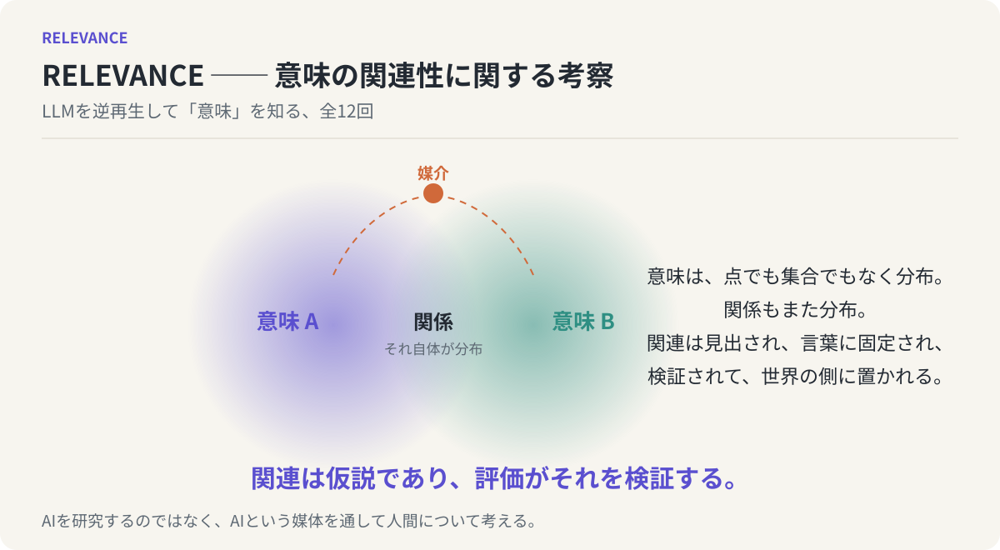

# 意味の関連性

## RELEVANCE ── 関連性に関する考察、全12回



**関連は仮説であり、評価がそれを検証する。**

LLMは言葉を扱う装置であり、確率的に尤もらしい次の言葉を選び続けているだけなのに、外から見ると意味を理解しているように映る。この連載は、LLMの仕組みを解き明かすのではなく、その振る舞いを逆再生して「意味とは何か」に近づく試みである。問いはただ一つ、**二つのものが「関係している」とは、どういう事態なのか**。この一点をほぐしていくと、創造的な思考プロセスの正体が見えてくる。各回は独立した読み物であり、末尾の一段落が次回へつながる。

[第1回から読む](chapters/01-reverse-engineering-meaning.md) ／ [最終回を読む](chapters/12-relevance-as-hypothesis.md) ／ [読み方](guides/READING.md)

## 全12回の目次

| 回 | 文章 | 主題 |
| --- | --- | --- |
| 01 | [LLMを逆再生して「意味」を知る](chapters/01-reverse-engineering-meaning.md) | AI人文科学の宣言と、連載の見取り図 |
| 02 | [「似ている」は線ではない](chapters/02-similarity-is-not-a-line.md) | 同じ・違う・似ている、の食い違い |
| 03 | [意味は点でも集合でもなく、分布である](chapters/03-meaning-as-distribution.md) | 典型性の濃淡と、縁のない山 |
| 04 | [意味空間は歪んでいる](chapters/04-anisotropic-meaning-space.md) | 埋め込み空間の異方性 |
| 05 | [関係もまた分布である ──「中にある」と「間にある」](chapters/05-relation-as-distribution.md) | ズームの切り替え、双曲空間、家族的類似 |
| 06 | [アイデアとは、関係を見出すことである](chapters/06-ideas-as-finding-relations.md) | ヤングの定義と、関連は仮説に過ぎない |
| 07 | [2ホップという回路 ── 関連の多重性](chapters/07-two-hop-links.md) | 共通の媒介が関係をつくる |
| 08 | [生成は安く、評価は高い](chapters/08-generation-cheap-evaluation-expensive.md) | 創造性のボトルネックの所在 |
| 09 | [取り出しの速さ、そして「A、B or C」](chapters/09-retrieval-speed-and-a-b-or-c.md) | 言葉を先に置くこと、比喩という装置 |
| 10 | [ハルシネーションと創作に境界はない](chapters/10-hallucination-and-creation.md) | 生成と検証、記憶と幻覚 |
| 11 | [言葉は意味のハンドルである](chapters/11-words-as-handles.md) | 体験と言葉、LLMと人間の非対称 |
| 12 | [関連は仮説であり、評価がそれを検証する](chapters/12-relevance-as-hypothesis.md) | 全体の統合と、次の問い |

第I部（1〜4回）は意味の形を追い、「似ている」を解体して意味を歪んだ分布として捉え直す。第II部（5〜8回）は関係そのものを分布と見なし、関係を見出すことがアイデアであり、ボトルネックは生成ではなく評価にあることへ進む。第III部（9〜11回）は、境界のない意味を人間がどう掴んでいるかを、比喩、検証、そして言葉を「意味の取っ手」と見る見方で扱う。第IV部（12回）が全体を束ねる。

<!-- SITE-INDEX-END: 以下はリポジトリ利用者向け。HTML閲覧版のトップページには含めない。 -->

## GitHubで読む

このREADMEと各回の `.md` をGitHubの **Preview** で開く。本文中の図は相対リンク先のSVGとして表示される。外部の画像やフォントは参照しない。挿絵13点は編集可能な独立SVGであり、`scripts/draw_figures.py` から決定論的に再生成できる。数式は使っていない。

## ブラウザで読む（GitHub Pages）

公開ページは https://yamaguchiyoshito.github.io/relevance/ にある。`main` ブランチへのpushで `.github/workflows/pages.yml` が `_site/` を生成し、GitHub Pagesへ配置する。有効にするにはリポジトリの Settings → Pages → Build and deployment で Source を **GitHub Actions** にする。手順の詳細は[公開手順](guides/PUBLISHING.md)にある。

ローカルで再生成するにはPython 3.11以降とPandoc 3.xを使う。依存パッケージの追加インストールは不要である。

```sh
python scripts/validate.py
python scripts/build.py
python -m unittest discover -s tests -v
```

`_site/index.html` が目次付きの閲覧ページ、`_site/complete.html` が全12回とSVGを一つにまとめた単独ファイルである。GitHub管理対象はMarkdownとSVGなどの原本であり、`_site/` は生成物として `.gitignore` で除外する。

## 連載の成り立ちと編集

元はスライド資料（63枚）と単発のエッセイ草稿で、それを4部構成・全12回に再設計した。設計の意図、各回の核となる主張、素材の対応表は[連載構成案](guides/SERIES-DESIGN.md)に残してある。各回は「冒頭の違和感 → 核となる主張 → LLMと人間を対照する鏡 → 次回への橋」という型で書かれ、「関連は仮説に過ぎない」「境界は明確か」「中にある／間にある」という三つのリフレインが回をまたいで反復する。

[編集ガイド](guides/EDITING.md)に原本と生成物の責務をまとめた。[読み方](guides/READING.md)に表示環境の注意をまとめた。

## 出典へ戻る

[参考文献と確認範囲](references/bibliography.md)から各回の脚注の出典を参照できる。本文の脚注はその理論や逸話の参照先であり、原文の引用ではない。ケン・リュウの作品からの引用は要約である。確認範囲は資料ごとに明記し、全文未確認のものを確認済みとは表示していない。

本連載の主張のうち、埋め込み空間の異方性、双曲空間への埋め込み、PageRankやGraphRAGについては研究や実装の裏づけがある。人間の意味空間にも同様の歪みがあるという見立てや、人間とLLMの対照から引き出した解釈は、本連載が置いた仮説である。

## ライセンス

ライセンスは未設定である。公開する前に、本文・図のライセンスを決めて `LICENSE` を追加する。
