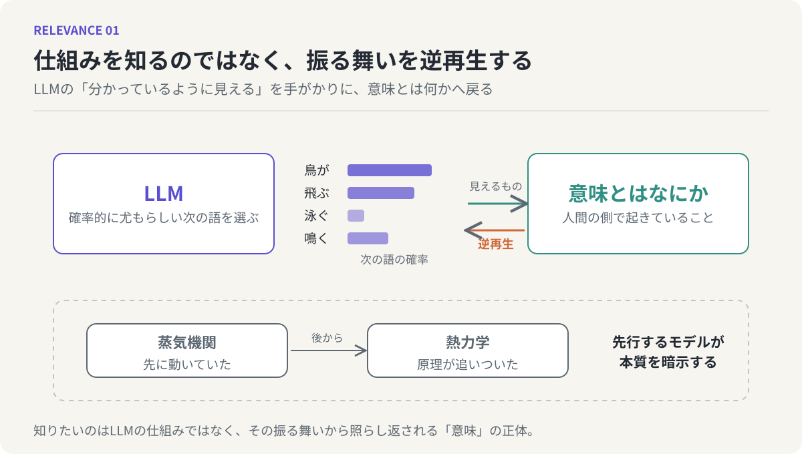

# 第1回　LLMを逆再生して「意味」を知る

## AI人文科学の宣言と、連載の見取り図

<!-- NAV:TOP -->
[連載目次](../README.md) | [第2回 →](02-similarity-is-not-a-line.md)
<!-- /NAV -->

LLMと話していると、ふと「こいつ、分かっているな」と感じる瞬間があります。曖昧に投げた質問の意図を汲んで答えてくる。言い淀んだ部分を補って返してくる。そのたびに、画面の向こうに何か知性のようなものが宿っているように見えます。

けれども、中で起きていることはひどく素朴です。LLMは言葉を扱う装置であり、広大な言語空間の中から「確率的に尤もらしい次の言葉」を選び続けているだけです。意味を理解しているわけではない。少なくとも、そう設計されてはいない。それなのに、外側から見ると意味を理解しているかのように振る舞う。この食い違いが、まず最初の違和感です。

### 知りたいのはLLMではない

ここで一つ、はっきりさせておきたいことがあります。わたしはLLMのことを理解したいわけではありません。モデルの内部構造や学習の手順を解き明かしたいのではないのです。知りたいのは、「意味とはなにか」という古い問いのほうです。

ただ、その問いに正面から向かうのではなく、LLMの振る舞いから逆再生するかたちで近づいてみたい。意味を理解していないはずの装置が、意味を理解しているように見える。ならば、その「見える」を成り立たせている仕組みの中に、意味というものの正体の一部が映り込んでいるのではないか。装置の挙動を手がかりに、人間の側で起きていることを照らし返す。そういう順序で考えてみたいのです。

*図1：左はLLMが次の語を確率で選ぶ様子。右へ向かう矢印が外から「見えるもの」、左へ戻る矢印が本連載の方法である逆再生。下段は、理論より先に動いていた蒸気機関の例。*

### 先行モデルが本質を暗示する

この順序は、それほど奇妙なものではありません。蒸気機関は、熱力学が確立されるよりも先に動いていました。機関が動いているという事実が先にあり、なぜ動くのかを説明する理論は後から追いついてきた。動くものを先に作ってしまい、そこから原理を読み取る。科学の歴史にはそういう場面が繰り返し出てきます。

LLMについても、同じことが言えるのではないかと思っています。人間の振る舞いに似たものが先にできてしまった。それがなぜ人間らしく見えるのかは、まだ十分に説明されていません。しかし、似たものが動いているという事実そのものが、知性や意味の本質について何かを暗示している。先行するモデルが、本質を先に見せてしまっている。

だからこれは、AIを研究する試みではありません。AIという媒体を通して人間について考える試みです。仮に名前をつけるなら、AI人文科学とでも呼べばよいでしょうか。この連載は、その試みの最初の素描になります。

### 一本の問い

テーマは「意味の関連性」に絞ります。もっと言えば、ただ一つの問いに絞ります。

**二つのものが「関係している」とは、どういう事態なのか。**

あまりに素朴な問いに見えるかもしれません。しかし、この一点をほぐしていくと、意外なほど多くのものが芋づる式に出てきます。「似ている」とはどういうことか。意味に境界はあるのか。アイデアはどこから来るのか。比喩はなぜ通じるのか。LLMの出力が時に嘘になるのはなぜか。言葉と体験はどうつながっているのか。これらはすべて、「関係している」という事態をどう捉えるかで答えが変わります。

そして最後には、創造的な思考プロセスとは何なのか、という問いにたどり着くはずです。関係を見出すこと、それ自体がアイデアであると、わたしは考えています。

### 連載の見取り図

全12回を、四つの部に分けて進めます。

第I部（第1回〜第4回）では、「意味は分布である」という見方を立てます。「似ている」を一本の線として思い描くことの誤りから始め、意味を点でも集合でもなく確率的な分布として捉え直します。さらに、その分布が素朴な丸ではなく歪んだ形をしていることまで見ていきます。

第II部（第5回〜第8回）では、意味だけでなく「関係」そのものを分布と見なします。そこから、関係を見出すことがアイデアであること、関連は常に仮説に過ぎないこと、そして創造性のボトルネックは組み合わせを作る側ではなく価値を見抜く側にあることへ進みます。

第III部（第9回〜第11回）では、分布のように境界のない意味を、人間がどうやって掴んで操作しているのかを考えます。比喩、検証、そして言葉を「意味のハンドル」と見る見方を扱います。ここでLLMと人間の決定的な非対称にも触れます。

第IV部（第12回）で、全体を一つに束ねます。「関連性を見出す力」とは何なのかを、この連載なりの言葉で言い直して終えるつもりです。

### 誰に向けて書くか

言語学や認知科学に興味がある人。創造性や思考のプロセスについて考えたい人。アイデアを出す力を伸ばしたい人。あるいは単に、意味や関係性の本質について考えてみたい人。そのどれか一つに当たれば、読み進める価値はあると思います。

専門的な道具も時おり持ち出します。確率分布、埋め込み空間、グラフの話などです。ただし、それらは主張の根拠として使うだけで、主張そのものは日常の言葉で立てるようにします。数式は出しません。

### 次回へ

出発点は、最も素朴な関係からにします。「AとBは似ている」と言うとき、わたしたちは頭の中に何を描いているでしょうか。おそらく、AとBを結ぶ一本の線です。次回は、その線が本当にそこにあるのかを疑ってみます。

<!-- NAV:BOTTOM -->
---

[連載目次](../README.md) | [第2回 →](02-similarity-is-not-a-line.md)
<!-- /NAV -->
