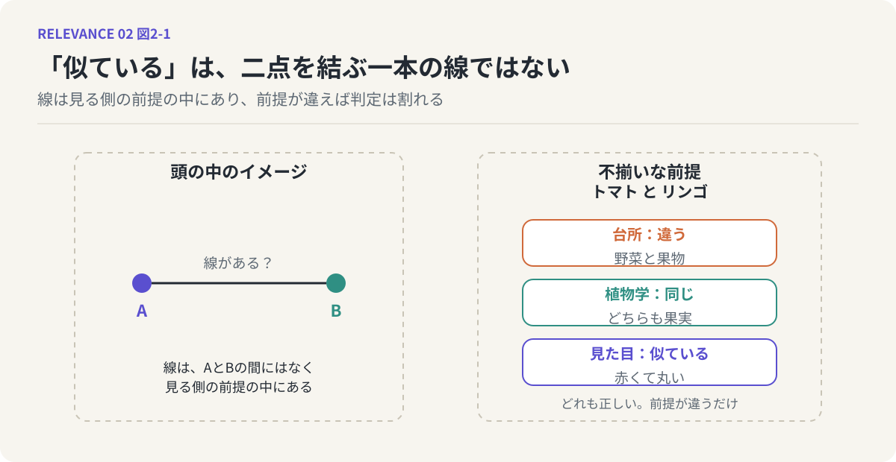
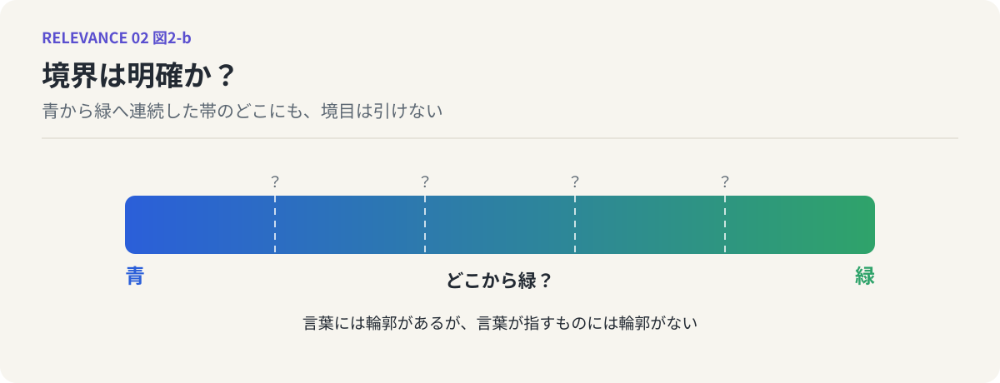

# 第2回　「似ている」は線ではない

## 同じ・違う・似ている、の食い違い

<!-- NAV:TOP -->
[← 第1回](01-reverse-engineering-meaning.md) | [連載目次](../README.md) | [第3回 →](03-meaning-as-distribution.md)
<!-- /NAV -->

「関係がある」と一言で言っても、関係にはいろいろな種類があります。親子という関係。原因と結果という関係。部分と全体、手段と目的、前と後。同じ店で買ったという関係もあれば、名前の響きが近いというだけの関係もあります。この連載は「関係しているとはどういう事態か」を問うものですが、いきなり関係一般を扱うと手に余ります。そこで、最も素朴で、最も日常的に口にする関係から入ることにします。「似ている」です。

### 頭の中の一本の線

「AとBは似ている」と言うとき、わたしたちは何を思い描いているでしょうか。たぶん、AとBという二つの点があって、その間に一本の線が引かれている図です。似ていれば線がある。似ていなければ線がない。線が太ければよく似ていて、細ければ少しだけ似ている。そんなイメージです。

このイメージはとても自然で、だからこそ疑いにくい。けれども、これは本当に「似ている」という事態を正しく捉えているでしょうか。少し立ち止まって、「似ている」が実際にどう使われているかを見てみます。

### 食い違う三つの判定

「同じ」「違う」「似ている」という三つの判定は、驚くほどよく食い違います。

たとえばトマトです。料理をする人にとって、トマトは野菜です。サラダに入れ、煮込みに使う。しかし植物の分類では、トマトは果実です。花が咲いたあとに実るものだからです。では、トマトとリンゴは「同じ」グループでしょうか、「違う」グループでしょうか。台所では違い、植物学では同じになります。どちらも正しい。前提が違うだけです。

音楽でも起きます。ある曲のカバー、リミックス、ライブ録音。これらは原曲と「同じ曲」でしょうか。歌詞とメロディが同じなら同じ曲だと言う人もいれば、テンポも編成も違うのだから別物だと言う人もいます。「似ている」と言えばたいていの人は納得しますが、「同じ」と言い切ると途端に揉めはじめる。

もっと身近な場面もあります。「あの子、お父さんに似てるね」と言われて、「そう？ 全然似てないと思うけど」と返される。一方は目元を見ていて、もう一方は声や仕草を見ている。同じ二人を見比べているのに、判定が割れる。

### 不揃いな前提

こうした食い違いは、どちらかが間違っているから起きるのではありません。比べるときに持ち出している前提が、互いに揃っていないから起きます。トマトの例では「何のための分類か」が、音楽の例では「曲の同一性をどこに置くか」が、親子の例では「どの特徴を見るか」が、それぞれ食い違っていました。

ここで、先ほどの「一本の線」のイメージに戻ってみます。線のイメージでは、AとBの間に線があるかないかは、AとBだけで決まるはずです。しかし実際には、誰がどんな前提で見ているかによって、線は現れたり消えたりする。線はAとBの間にあるのではなく、見る側の前提の中にある。少なくとも、そう考えないと説明がつかない。

*図2-1：左は「似ている」を二点を結ぶ線として思い描く素朴なイメージ。右は同じトマトとリンゴが、前提によって違う・同じ・似ているに割れる様子。*

### 境界は明確か？

さらに一歩踏み込みます。前提が揃わないというだけなら、前提を揃えればよいという話になります。しかし問題はそこで終わりません。前提を揃えたとしても、「同じ」と「違う」の境目はきれいに引けるでしょうか。

信号の色を思い浮かべてください。日本では「青信号」と呼びますが、実際に光っているのは緑に近い色です。青と緑の境目はどこにあるのか。色相を少しずつずらしていったとき、どこかで「ここから緑」と線を引けるでしょうか。引けません。引けるように感じるのは、わたしたちが「青」と「緑」という二つの言葉を持っていて、言葉のほうには境目があるからです。

*図2-2：青から緑へ連続した帯。どこにも「ここから緑」という線は引けない。線があるように感じるのは、言葉のほうに輪郭があるからである。*

ここに、わたしたちが日常的に犯している勘違いの正体があります。境界が明確でないものに対して、境界が明確であるかのように扱ってしまう。言葉には輪郭がある。しかし言葉が指しているもののほうには、輪郭がない。それなのに、言葉の輪郭を、意味そのものの輪郭だと思い込んでしまう。

「同じ／違う／似ている」が食い違うのは、前提が揃っていないからだけではありません。もっと根本的には、意味に明確な境界があるという前提そのものが、無意識のうちに置かれているからです。線があるかないか、同じか違うかという二値で考えはじめた瞬間に、本来は濃淡でしかないものを白黒に塗り分けてしまっている。

### 鏡：LLMも同じ勘違いを再生産する

ここでLLMに目を向けてみます。LLMの内部では、言葉はベクトルという数の並びとして扱われ、二つの言葉の「近さ」が数値で計算されています。この近さがいわゆる類似度で、「似ている」の機械的な代用品だと言ってよいでしょう。

興味深いのは、この類似度がしばしば的外れになることです。明らかに関係のない言葉同士が「近い」と判定される。人間が見ればまったく似ていないものが、数値上は似ているとされる。つまりLLMもまた、「似ている」の判定でつまずいている。そしてその原因は、単に計算が粗いからではなさそうなのです。人間が言葉の輪郭を意味の輪郭だと思い込むのと、どこか対応する構造的な理由がある。その話は第4回で詳しく扱います。ここでは、人間とLLMが同じ場所でつまずいている、という事実だけを留めておいてください。

### 次回へ

「似ている」は一本の線ではなく、見る側の前提の中にあり、しかもその判定には明確な境目がない。ここまで来ると、次の問いが自然に立ちます。線でも、白黒の所属でもないなら、意味はいったいどんな形をしているのか。次回は、その形を「分布」という言葉で描いてみます。

<!-- NAV:BOTTOM -->
---

[← 第1回](01-reverse-engineering-meaning.md) | [連載目次](../README.md) | [第3回 →](03-meaning-as-distribution.md)
<!-- /NAV -->
