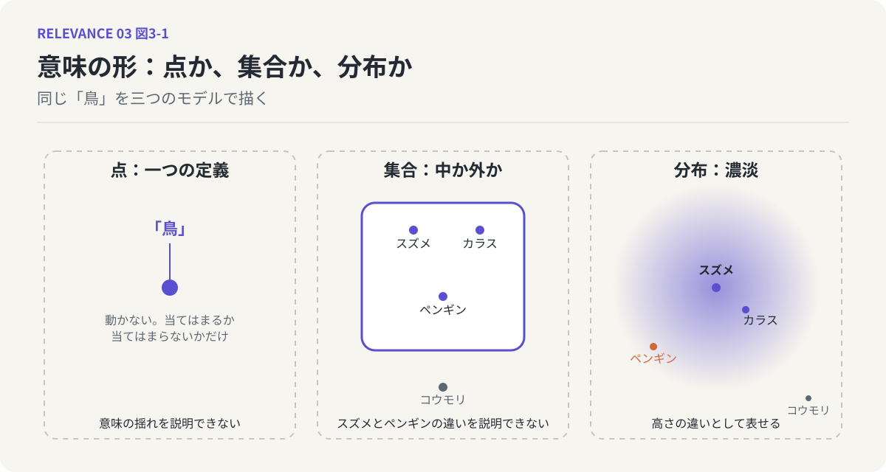
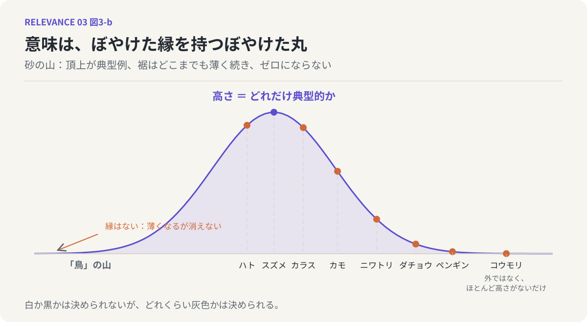
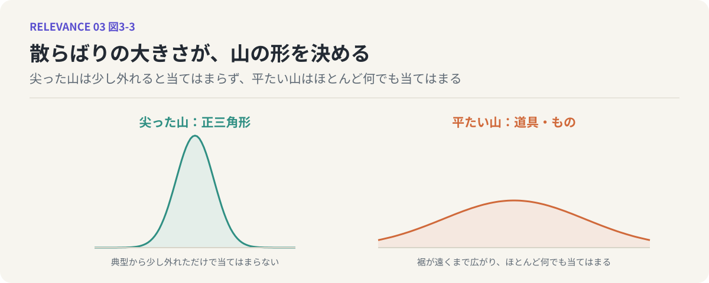

# 第3回　意味は点でも集合でもなく、分布である

## 典型性の濃淡と、縁のない山

<!-- NAV:TOP -->
[← 第2回](02-similarity-is-not-a-line.md) | [連載目次](../README.md) | [第4回 →](04-anisotropic-meaning-space.md)
<!-- /NAV -->

「鳥」と言われて、ペンギンを思い浮かべる人はまずいません。出てくるのはスズメやカラス、ハトあたりでしょう。空を飛ぶ、小さい、くちばしがある。そういうものが「鳥」と聞いた瞬間に浮かびます。けれどもペンギンは鳥です。ダチョウも鳥です。飛ばないし、小さくもない。それでも鳥であることに誰も異を唱えない。

このとき、スズメとペンギンは「鳥」という意味の中で、同じ扱いを受けているでしょうか。どちらも鳥であることに違いはない。しかし、鳥らしさの度合いは明らかに違う。前回の言葉を使えば、所属は同じでも、濃淡が違う。今回は、この濃淡を正面から扱います。

### 三つのモデル

意味の形を考えるとき、わたしたちが無意識に使っているモデルは、おおよそ三つあります。

一つめは、意味を**点**とみなすモデルです。辞書の見出し語のように、一つの言葉には一つの決まった意味があり、それはピンで留めたように動かない。このモデルでは、「鳥」はただ一つの定義であり、スズメもペンギンもその定義に当てはまるかどうかで判定されます。

二つめは、意味を**集合**とみなすモデルです。「鳥」とは、羽毛があり、卵を産み、くちばしを持つものの集まりである。条件を満たせば中、満たさなければ外。中と外を分ける境界線がはっきりある。前回見た「同じか違うか」の二値的な考え方は、このモデルに支えられています。

点のモデルは、意味が揺れることを説明できません。集合のモデルは、スズメとペンギンの鳥らしさの違いを説明できません。どちらも中にいるのだから、集合の立場では同じ扱いになるはずです。しかし実感はそうなっていない。

そこで三つめのモデルが必要になります。意味を**分布**とみなすモデルです。

*図3-1：同じ「鳥」を三つのモデルで描いた。点は揺れを説明できず、集合はスズメとペンギンの違いを説明できない。分布は、その違いを高さの違いとして表せる。*

### 砂の山

分布と言うと数学の話に聞こえますが、イメージは単純です。砂を一か所に、上から少しずつ落としていくところを想像してください。砂は山になります。落とした真下が一番高く、そこから離れるにつれて低くなり、裾のほうは薄く広がっていく。

この山が、意味の形です。山の頂上にあるのが、その言葉の最も典型的な例です。「鳥」の山なら、頂上にはスズメやハトがいる。少し下ったところにカラスやカモがいる。さらに裾へ行くとニワトリ、ダチョウ、そしてペンギンがいる。ペンギンは山の上にいる。ただし、ずいぶん低いところに。

*図3-2：意味を砂の山として描いたもの。高さが典型性を表し、裾はどこまでも薄く続いてゼロにならない。コウモリは外にいるのではなく、ほとんど高さがないだけである。*

この山には、いくつか大事な性質があります。

まず、山の高さは「どれだけ典型的か」を表しています。中心に近いほど高く、離れるほど低い。だからスズメとペンギンの違いは、所属の違いではなく、高さの違いとして表せます。

次に、山には縁がありません。砂の山の裾は、よく見るとどこまでも薄く続いていて、「ここで砂が終わる」という線を引くことができません。意味もそうです。中心から遠ざかるほど、その言葉が当てはまる度合いは下がっていきますが、完全にゼロになる地点はありません。「コウモリは鳥か」と問われれば、ほとんどの人が違うと答えるでしょう。しかし、まったく鳥らしさがないとも言いにくい。飛ぶし、小さいし、群れる。コウモリは「鳥」の山の、ごく低い裾のあたりにいる。外にいるのではなく、ほとんど高さがないだけです。

そして、山の形は一つの数で言い表せます。砂をどれだけ中心から離れた位置に落としたかという散らばりの大きさです。この散らばりが小さければ、山は高く尖り、裾はすぐに薄くなる。「正三角形」のように、典型例から少し外れただけで当てはまらなくなる言葉は、こういう尖った山です。散らばりが大きければ、山は低くなだらかになり、裾が遠くまで広がる。「道具」や「もの」のように、ほとんど何でも当てはまる言葉は、こういう平たい山をしています。

*図3-3：散らばりの大きさの違い。尖った山（正三角形）は典型から少し外れると当てはまらず、平たい山（道具）はほとんど何でも当てはまる。*

### 含まれる、という確率

分布のモデルでは、「ペンギンは鳥に含まれるか」という問いの立て方そのものが変わります。含まれるか含まれないかではなく、どれくらいの度合いで含まれるか、を問うことになる。中心からの距離が分かれば、その地点の高さが分かり、高さが分かれば「典型的である度合い」も「許容範囲に収まっている度合い」も読み取れます。

これは、前回の「境界は明確か？」という問いに対する、ひとつの答えでもあります。境界は明確ではない。しかし、境界がないからといって、何でもありになるわけではない。中心からどれだけ離れているかによって、濃淡はきちんと決まっている。白か黒かは決められないが、どれくらい灰色かは決められる。分布のモデルが与えてくれるのは、この「決められる」という感覚です。

まとめて言えば、意味は点でもなく、集合でもなく、ぼやけた縁を持つぼやけた丸です。中心は濃く、外へ向かうほど薄くなり、どこまで行っても完全には消えない。

### 鏡：「なんとなく」と確率

ここで、LLMを鏡にしてみます。LLMは次に来る言葉を確率で選ぶ装置だと第1回で述べました。「鳥」の次に「が飛ぶ」が来る確率、「が泳ぐ」が来る確率。LLMの中では、言葉はつねにこうした確率の濃淡として扱われています。中にあるか外にあるかではなく、どれくらいありそうか。

一方、人間が「鳥」と聞いてスズメを思い浮かべるのも、よく考えれば確率的な出来事です。スズメが出てくる確率が高く、ペンギンが出てくる確率が低い。「なんとなく鳥っぽい」「鳥と言えば鳥だけど」という曖昧な言い回しは、わたしたちが日常的に、山の高さを読み取っていることの表れです。

人間の「なんとなく」と、LLMの確率は、ここで同じ形をしています。どちらも、意味を白黒の所属ではなく、濃淡の分布として扱っている。LLMの振る舞いから逆再生して見えてくるのは、人間もまたずっと前から分布で考えていた、ということです。

### 次回へ

意味はぼやけた丸である。ここまで来れば、第I部の骨格はほぼできあがっています。ただし、まだひとつ訂正しておかなければならないことがあります。わたしはこの丸を、砂の山のように、中心から四方へ均等に広がるものとして描きました。実際の意味の形は、そんなに素直ではありません。次回は、この丸が実はひどく歪んでいることを見ていきます。

<!-- NAV:BOTTOM -->
---

[← 第2回](02-similarity-is-not-a-line.md) | [連載目次](../README.md) | [第4回 →](04-anisotropic-meaning-space.md)
<!-- /NAV -->
