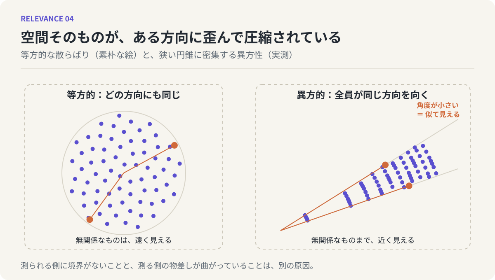

# 第4回　意味空間は歪んでいる

## 埋め込み空間の異方性

<!-- NAV:TOP -->
[← 第3回](03-meaning-as-distribution.md) | [連載目次](../README.md) | [第5回 →](05-relation-as-distribution.md)
<!-- /NAV -->

「なんとなく似ている気がするんだけど、どこがと言われると説明できない」。そういう感覚を持ったことはないでしょうか。二つの映画、二人の知人、ある街とある曲。並べてみると確かに何かが通じている。けれども、どの特徴が共通しているのかを指さそうとすると、指が止まる。

前回までの話で言えば、これは「似ている」の判定が揺れている場面です。第2回では、揺れの原因を「意味に境界がないのに、境界があるかのように扱ってしまうこと」に求めました。今回は、もう一つの原因を加えます。揺れは、測られる側だけの問題ではありません。測る側、つまり意味が置かれている空間そのものが、歪んでいるのです。

### 砂の山の訂正

第3回で、意味を砂の山として描きました。中心から四方へ、どの方向にも同じように裾が広がっていく山です。数学ではこういう広がり方を「等方的」と呼びます。方向によって性質が変わらない、という意味です。

ところが、LLMの内部で言葉がどう配置されているかを実際に調べてみると、この等方的な絵はあまり正確ではないことが分かっています。ニューラル言語モデルは、それぞれの言葉を「埋め込み」と呼ばれる数の並びに変換します。この数の並びは、何百、何千という次元を持つ空間の中の一点だと考えることができます。もし意味が等方的に散らばっているなら、言葉たちはこの広大な空間のあちこちに、まんべんなく配置されているはずです。

実際はそうなっていません。言葉のベクトルは、空間のごく狭い一角に、偏って密集しています。[^ethayarajh]たとえて言えば、懐中電灯の光が描く細い円錐の中に、すべての言葉が押し込められているような状態です。この偏りを「異方性」と呼びます。方向によって性質が違う、等方的ではない、という意味です。

### 全員が同じ方向を向いた群衆

異方性が何をもたらすかを、別の絵で考えてみます。

広場に大勢の人が立っているとします。もし人々がばらばらの方向を向いていれば、「あの二人は同じ方向を見ている」という観察には意味があります。たまたま同じ方向を見ている二人には、何か共通の関心があるのかもしれない。

しかし、広場の全員がほぼ同じ方向を向いていたらどうでしょう。どの二人を選んでも「同じ方向を見ている」ことになります。この観察はもう、二人の間の関係について何も教えてくれません。全員がそうなのだから。

LLMの中の言葉たちは、この後者の群衆に近い状態にあります。ベクトル同士の近さは、しばしば「向きがどれだけ揃っているか」で測られます。コサイン類似度と呼ばれる尺度です。ところが言葉たちがもともと狭い円錐の中に密集していると、どの二つの言葉を取っても向きが揃って見えてしまう。本来まったく無関係な単語同士でも、類似度が不自然に高く出る。前回の砂の山に戻って言えば、山の裾がある方向にだけ引き伸ばされていて、その方向に沿って並んだものは、実際より近く見えるのです。

なぜこんな偏りが生じるのかについては、いくつかの説明があります。頻繁に現れる言葉がベクトルの共通成分を支配してしまうこと、学習の過程で全体がある方向へ押し流されやすいこと、などです。[^gao]細部はここでは追いません。大事なのは、この偏りが偶然のノイズではなく、測定して確認できる構造的な性質だということです。実際、言葉たちの共通の向きを計算して差し引いてやると、類似度の判定が目に見えて改善することも報告されています。[^mu-viswanath]歪みは実在し、しかも補正できる。

*図4：左は意味がどの方向にも同じように散らばる素朴な絵。右は実際の埋め込み空間の様子で、点が狭い円錐に密集し、無関係な二点（橙）でも中心からの角度が小さくなるため似て見える。*

### 二つの原因

ここまでで、「似ている」の判定が揺れる原因が二つ揃いました。

一つは、第2回で見た、意味そのものに境界がないという事実です。測られる側がぼやけている。

もう一つは、今回見た、意味が置かれている空間が歪んでいるという事実です。測る側の物差しが曲がっている。

この二つは別のものです。境界がぼやけているだけなら、近いものは近く、遠いものは遠く見えるはずで、ただ「どこまでが近いか」の線が引けないだけです。しかし空間が歪んでいると、遠いものが近く見えてしまう。似ていないものが似ているように感じられる。冒頭の「説明できないのに似ている気がする」という感覚は、境界の曖昧さだけでは説明がつきません。似ていると感じる根拠が実は存在せず、歪みのせいで近く見えているだけ、という可能性があるからです。

### 鏡：説明できない違和感の出どころ

ここでLLMを鏡にします。LLMの類似度判定が時に的外れになる理由は、いま見た異方性でかなりの部分が説明できます。無関係なものが近いと判定される。それは計算の粗さではなく、空間の形がそうなっているからです。

では人間はどうか。人間の頭の中にも、何らかの意味空間があると考えてよいなら、そこにも似た歪みがあるのではないか。たとえば、わたしたちが何かを知覚するとき、好きか嫌いか、見慣れているかいないか、といった少数の軸がほとんどすべてのものに色をつけています。これらの軸があまりに強いと、本来は無関係な二つのものが「どちらも懐かしい」「どちらも少し怖い」というだけで、妙に似て感じられる。全員が同じ方向を向いた群衆と、同じ構造です。

これはまだ仮説です。しかし、LLMで実測された歪みが、人間の「説明できない似ている感」にそのまま重なって見えることは、少なくともこの連載の方法、つまりLLMの振る舞いから人間を照らし返す方法が、空振りではなさそうだと教えてくれます。

### 第I部の締めくくり

第I部では、意味の形を追ってきました。「似ている」は二点を結ぶ線ではない（第2回）。意味は点でも集合でもなく、ぼやけた縁を持つ分布である（第3回）。そしてその分布は等方的な丸ではなく、ある方向に偏って圧縮された、歪んだ形をしている（第4回）。

意味の形が見えてきたので、次は「関係」の形を問う番です。第2回で退けた「二点を結ぶ線」のイメージに、もう一度戻ります。線でないなら、関係はどんな形をしているのか。次回、関係そのものもまた分布であることを示し、「中にある」と「間にある」が両立するという、少し奇妙な事態を見ていきます。

## 参考文献・注記

[^ethayarajh]: Kawin Ethayarajh（2019）. [How Contextual are Contextualized Word Representations? Comparing the Geometry of BERT, ELMo, and GPT-2 Embeddings](https://aclanthology.org/D19-1006/)。EMNLP-IJCNLP 2019。文脈化された単語埋め込みが異方的であることを示した。
[^mu-viswanath]: Jiaqi Mu, Pramod Viswanath（2018）. [All-but-the-Top: Simple and Effective Postprocessing for Word Representations](https://openreview.net/forum?id=HkuGJ3kCb)。ICLR 2018。共通成分を差し引くことで類似度判定が改善することを示した。
[^gao]: Jun Gao, Di He, Xu Tan, Tao Qin, Liwei Wang, Tie-Yan Liu（2019）. [Representation Degeneration Problem in Training Natural Language Generation Models](https://openreview.net/forum?id=SkEYojRqtm)。ICLR 2019。学習過程で埋め込みが狭い円錐に退化する機序を論じた。

<!-- NAV:BOTTOM -->
---

[← 第3回](03-meaning-as-distribution.md) | [連載目次](../README.md) | [第5回 →](05-relation-as-distribution.md)
<!-- /NAV -->
