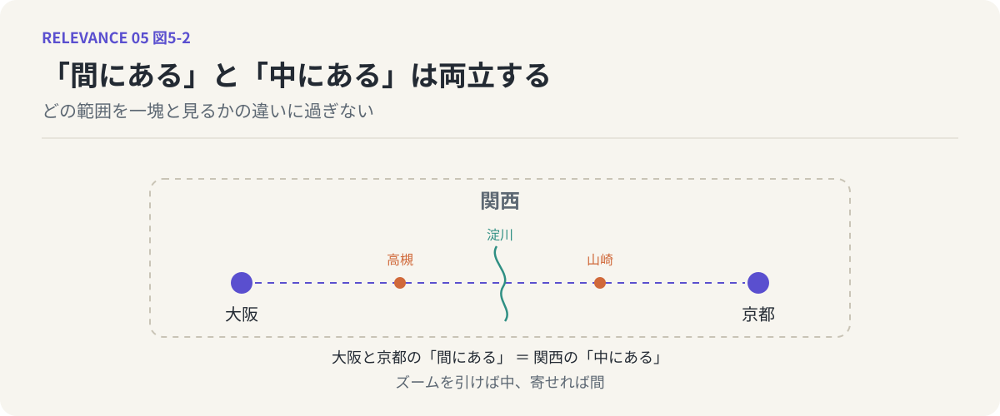
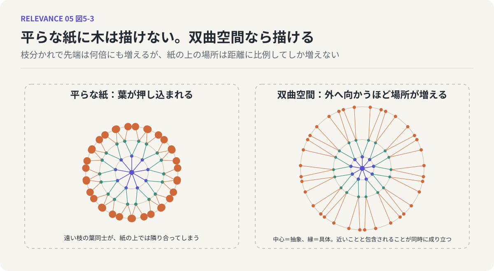
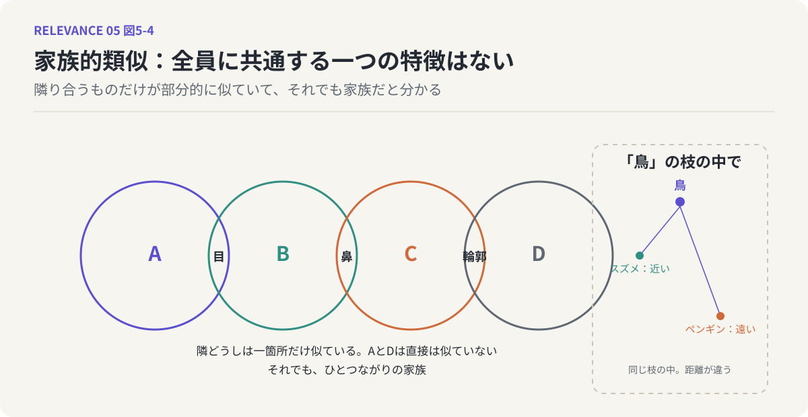

# 第5回　関係もまた分布である ──「中にある」と「間にある」

## ズームの切り替え、双曲空間、家族的類似

<!-- NAV:TOP -->
[← 第4回](04-anisotropic-meaning-space.md) | [連載目次](../README.md) | [第6回 →](06-ideas-as-finding-relations.md)
<!-- /NAV -->

{.opener}

第2回で、「似ている」を二点を結ぶ一本の線として思い描くことを疑いました。あのとき線を疑った理由は、線が見る側の前提によって現れたり消えたりするから、というものでした。第I部を通ってきたいま、もう一つ理由を足すことができます。線の両端にあるはずの「点」が、そもそも点ではなかったからです。

意味はぼやけた縁を持つ、歪んだ分布でした。ならば、AとBという二つのぼやけた丸の「間にある関係」とは、何なのでしょう。丸の中心と中心を結べば線は引けます。しかしその線は、丸の縁がどこにもないのと同じ理由で、関係の実態を捉えていないはずです。

### 関係は意味である

「海」と「夏」を並べてみます。この二つには関係がある、と誰でも感じるでしょう。ではその関係とは何か。海水浴、日焼け、花火の帰り道、潮の匂い、青い色。挙げていくと、「海と夏の関係」と呼んでいたものは、それ自体がひとつの意味の雲のように広がっていることに気づきます。中心のあたりには海水浴のような典型的なものがあり、縁のほうには個人的な記憶や、人によっては浮かばないものが薄く漂っている。

つまり、関係もまた分布なのです。AとBを結ぶ線ではなく、AとBの重なりや隣接のあたりに立ち上がる、それ自体がぼやけた縁を持つひとつの意味。関係は意味であり、意味が分布であるなら、関係も分布である。第I部で意味について言ったことは、そのまま関係にも当てはまります。

*図5-1：「海」と「夏」という二つの雲の重なりに、それ自体がぼやけた縁を持つ意味として関係が立ち上がる。*

### 「間にある」と「中にある」は両立する

ここから、少し奇妙な事態が見えてきます。

大阪と京都の間には、何があるでしょう。高槻や山崎といった町があり、淀川が流れ、新幹線が通っています。これらは「大阪と京都の間にある」ものです。しかし同時に、これらはすべて「関西の中にある」ものでもあります。間にあることと、中にあることは、矛盾していません。大阪と京都を二つの点として見れば「間」が現れ、関西というひとまとまりとして見れば「中」が現れる。違いは、どの範囲を一塊と認識しているかだけです。

「海」と「夏」でも同じです。海水浴は二つの「間にある」と同時に、「夏の海」というひとまとまりの「中にある」。ズームを引けば中になり、寄せれば間になる。もし関係が一本の線なら、線の上にあるものが同時に何かの内側にある、という言い方は意味をなさないでしょう。

*図5-2：大阪と京都の「間にある」ものは、関西の「中にある」ものでもある。違いは、どの範囲を一塊と見るかだけである。*

### 平らな紙に木は描けない

ただし、この両立を頭の中で安定して保つのは意外に難しい。その難しさには幾何学的な理由があります。

意味の多くは階層をなしています。動物の下に鳥があり、鳥の下にスズメやペンギンがある。この「〜は〜の一種である」という木構造を、まっすぐな距離で測れる普通の空間、いわゆるユークリッド空間に置こうとすると、どうしても歪みが出ます。

紙の上に木を描くところを想像してください。幹を中心に置き、枝を周りに、その枝から出る小枝をさらに外側に配置していく。枝分かれが一段進むごとに、先端の数は何倍にも増えます。ところが紙の上で使える場所は、中心から離れても、せいぜい距離に比例してしか増えません。段が深くなるほど先端は足りない場所に押し込められ、本来は遠い枝の葉同士が紙の上では隣り合ってしまう。次元を増やしても、この窮屈さは本質的には解消しません。前回見た「空間の歪み」の、別の顔です。

### 双曲空間という答え

この窮屈さを解く答えの一つが、双曲空間と呼ばれる幾何学です。

双曲空間は、中心から外へ向かうほど、使える場所が指数関数的に増えていく空間です。枝分かれで先端が何倍に増えても、受け止める場所も同じ勢いで増えるので、葉がぶつからない。エッシャーの「円の極限」のように、縁に近づくほど図形が無限に細かく詰まっていく、あの絵が双曲空間の一つの描き方です。

意味をこの空間に置くと、中心に近いほど抽象度の高い概念が、縁に向かうほど具体的な概念が並びます。動物は中心寄り、鳥はその外、スズメやペンギンはさらに外。この配置では、「スズメとカラスは距離が近い」ことと「どちらも鳥という同じ枝の下にある」ことが、ひとつの幾何の中で同時に成り立ちます。間と中が、見方の切り替えではなく、同じ空間の二つの読みとして両立する。

実際、言語モデルの研究では、階層的な意味関係を双曲空間に埋め込むと、ユークリッド空間よりずっと少ない次元で、はるかに正確に表現できることが示されています。[^nickel-kiela]意味の階層を表すには、双曲空間のほうが向いているのです。

*図5-3：左は平らな紙に描いた木で、枝分かれが進むほど葉が足りない場所に押し込まれ、遠い枝の葉が隣り合ってしまう。右は双曲空間のイメージで、外へ向かうほど場所が増えるので葉がぶつからない。*

### 家族的類似

この見方は、哲学の側からもすでに準備されていました。ウィトゲンシュタインは、「ゲーム」という言葉を例に、すべてのゲームに共通する一つの特徴は存在しないと論じました。ボードゲーム、球技、カードゲーム、一人遊び。それぞれは隣り合うものと部分的に似ているだけで、全員に共通する核はない。家族の顔のようなものです。目は父に、鼻は母に、輪郭は祖父に似ている。全員が共有する一つの特徴はないのに、家族だとは分かる。これを家族的類似と呼びます。[^wittgenstein]

認知言語学はこれを引き継ぎ、人間が実際に使うカテゴリーは必要十分条件で区切られた集合ではなく、典型例とそれへの類似で特徴づけられる、と考えるようになりました。[^rosch]第3回の鳥がそのまま当てはまります。スズメは典型例に近く、ペンギンは遠い。どちらも「鳥」という枝の中にあり、しかし枝の中での距離が違う。中と間が、ここでも同時に成り立っています。

*図5-4：左はA・B・C・Dが隣同士だけ部分的に似ていて、全員に共通する特徴はないのに一つの家族をなす様子。右は「鳥」という同じ枝の中で、スズメは典型例に近く、ペンギンは遠いことを示す。*

### 鏡：ズームの自在さ

LLMを鏡にします。双曲空間への埋め込みがうまくいくという事実は、LLMが扱う意味の世界に、木のような階層がぎっしり詰まっていることを示しています。

人間の側では、わたしたちは「大阪と京都の間」と「関西の中」をほとんど意識せずに切り替えています。この切り替えの自在さこそ、人間が双曲的な意味空間を生きている証拠なのかもしれません。間に見えていたものが、一歩引けば中に収まる。その感覚を、わたしたちは毎日使っている。

### 次回へ

関係は線ではなく分布であり、どの範囲を一塊と見るかで、間になったり中になったりする。ここまで来ると、関係は「あるかないか」が最初から決まっているものではなく、見る側が「見出す」ものだ、という言い方のほうが正確に思えてきます。次回は、この「見出す」という行為に名前をつけます。それはアイデアと呼ばれているものと、ほとんど同じものです。

## 参考文献・注記

[^nickel-kiela]: Maximilian Nickel, Douwe Kiela（2017）. [Poincaré Embeddings for Learning Hierarchical Representations](https://arxiv.org/abs/1705.08039)。NeurIPS 2017。階層構造を双曲空間に埋め込むと少ない次元で高精度に表現できることを示した。
[^wittgenstein]: ルートヴィヒ・ウィトゲンシュタイン（1953）. [哲学探究（第66〜67節）](https://ja.wikipedia.org/wiki/家族的類似)。「ゲーム」を例に家族的類似を論じた箇所。リンク先は概念の紹介ページであり原著ではない。
[^rosch]: Eleanor Rosch（1975）. [Cognitive Representations of Semantic Categories](https://doi.org/10.1037/0096-3445.104.3.192)。Journal of Experimental Psychology: General, 104(3)。典型例（プロトタイプ）によるカテゴリー把握の実証研究。

<!-- NAV:BOTTOM -->
---

[← 第4回](04-anisotropic-meaning-space.md) | [連載目次](../README.md) | [第6回 →](06-ideas-as-finding-relations.md)
<!-- /NAV -->
