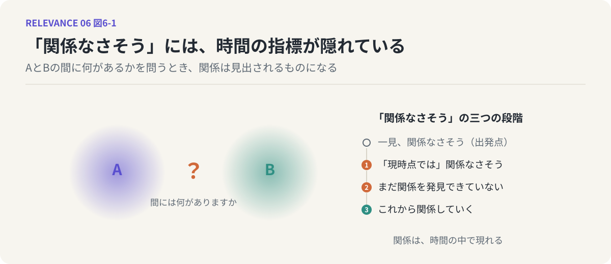
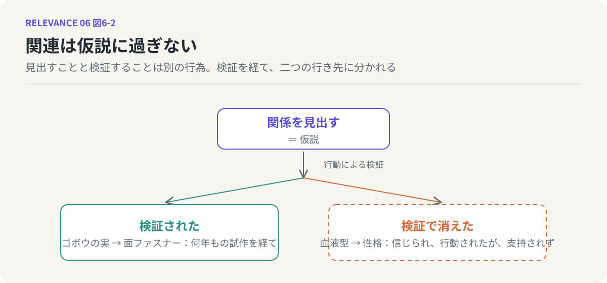

# 第6回　アイデアとは、関係を見出すことである

## ヤングの定義と、関連は仮説に過ぎない

<!-- NAV:TOP -->
[← 第5回](05-relation-as-distribution.md) | [連載目次](../README.md) | [第7回 →](07-two-hop-links.md)
<!-- /NAV -->

「AとBには関係がありますか？」

こう問われたとき、頭の中で何が起きているでしょうか。「ある」か「ない」かを即答できる場合もあります。しかしたいていは、少しの間、AとBの間を探しています。何かつながるものはないか。共通点はないか。一方が他方を引き起こすことはないか。この「探している間」に起きていることが、今回の主題です。

前回、関係は最初から「あるかないか」が決まっているものではなく、見る側が「見出す」ものだと言いました。見出すというのは、探してつなげようとする行為です。そして、つなげようとすることで、それまでなかったものが生まれる。この行為には、すでによく知られた名前がついています。アイデアです。

### ヤングの定義

広告の仕事をしていたジェームズ・W・ヤングは、1940年に出た小さな本の中で、アイデアとは何かを一文で言い切りました。アイデアとは、既存の要素の新しい組み合わせ以外の何ものでもない。[^young]

大事なのは「既存の」という部分です。アイデアは無から生まれない。手元の材料を、まだ試されていない仕方で組み合わせること。それがすべてだとヤングは言います。そしてもう一つ、続けて書いています。古い要素を新しく組み合わせる能力は、要素と要素の間に関係を見る能力に大きく依存している、と。

つまりヤングの定義は、この連載の言葉に翻訳できます。アイデアとは、まだ関係づけられていない二つの分布の間に、関係を見出すことである。既知の要素から出発し、手続きやルールに従いながら、新しい組み合わせを探る。うまくいけば、そこに新しい意味や価値が立ち上がる。うまくいかないことのほうが多い。組み合わせは本質的に確率的な営みで、当たりは少ないからです。

### 「関係なさそう」の三つの段階

ここで、「関係がない」という判定を少し疑ってみます。

一見、関係なさそうに見える二つのものがあるとします。この「関係なさそう」には、実は時間の指標が隠れています。正確に言えば、「現時点では」関係なさそうに見えている。もう一段言い換えれば、「まだ関係を発見できていない」だけかもしれない。さらに踏み込めば、二つはこれから「関係していく」のかもしれない。

関係は、時間の中で現れるものです。1940年代、スイスの技師が犬の散歩から帰ってきて、服にびっしりついたゴボウの実を顕微鏡で見ました。実の表面には小さな鉤が並んでいて、それが布の繊維に引っかかっていた。ゴボウの実と衣服の留め具には、それまで何の関係もありませんでした。しかし彼がそこに関係を見出し、何年もかけて試作を重ねた結果、面ファスナー、いわゆるマジックテープが生まれました。[^de-mestral]いまでは、ゴボウの実と留め具は「関係がある」ものとして語られます。関係は、発見された時点から過去にさかのぼって、ずっとそこにあったように見えはじめる。けれども、見出される前には、誰の目にもなかったのです。

*図6-1：左はAとBの間に何があるかを問う場面。右は「関係なさそう」に隠れた時間の指標で、一見から「これから関係していく」までの四段階。*

### 関連は仮説に過ぎない

ただし、ここで気をつけなければならないことがあります。関係を見出した瞬間に、その関係が本物になるわけではありません。

ゴボウの実と留め具の関係は、見出された時点では一つの思いつきでした。本物になったのは、技師が試作品を作り、鉤の形や素材を変え、何度も失敗したうえで実用になる製品にたどり着いたからです。見出すことと検証することは、別の行為です。

検証されなかった側の例もあります。血液型と性格の間に関係があるという考えは、日本ではよく知られています。これも、二つの分布の間に関係を見出した一例です。そして多くの人がそれに基づいて行動してきました。相性を占い、人を評価し、採用の話題にまで持ち込まれたことがあります。しかし、血液型と性格傾向の間に統計的に意味のある関係があるかを調べた研究は、繰り返し、それを支持しない結果を出してきました。[^nawata]関係は見出された。行動もされた。けれども、検証の段階で消えた。

*図6-2：見出された関係は仮説であり、行動による検証を経て二つの行き先に分かれる。実線の枠は検証を通った関係、破線の枠は仮説のまま消えた関係。*

この二つの例が示しているのは、同じことです。二つのものに関連を見出すことは、有益な変化のきっかけになることがある。しかし、それが実際に有益な変化をもたらすかどうかは、行動によって検証されなければ分からない。検証される前の関連は、どれほど確信を持って見出されたものであっても、仮説に過ぎません。

この一文は、この連載の中で何度か戻ってくることになります。関連は仮説に過ぎない。

### 問いの形を変える

冒頭の問いに戻ります。関係が見出すものであり、見出されたものが仮説であるなら、「ありますか？」という問いは少し窮屈です。「ある」か「ない」かの二択は、関係を最初から決まったものとして扱っているからです。

問いの形を変えてみます。「AとBには関係がありそうですか？」。これなら、仮説であることが問いに含まれます。さらに、「AとBはどういう関係ですか？」。関係の有無ではなく、関係の中身を問うことになる。そしてもう一歩、「AとBの間には何がありますか？」。前回の言葉で言えば、二つの分布の間に立ち上がる意味の雲を、直接問うことになります。

三つめの問いまで来ると、必要なのは判定ではなく生成です。間にあるものを言葉で埋めていく。それはアイデアを出すことそのものです。

### 鏡：LLMは「ない」と言わない

LLMに「AとBには関係がありますか？」と尋ねてみると、ある特徴に気づきます。LLMはめったに「関係はありません」と答えない。どんなに離れた二つを並べても、何かしらつながりを見つけて返してきます。これは、LLMが問いを最初から「間には何がありますか」の形で受け取っているからだと考えられます。確率的に尤もらしい言葉で間を埋める装置なのだから、間はいつも何かで埋まる。

関係を見出す能力としては、人間の連想とよく似ています。人間も、二つを並べられれば何かしらのつながりを見つけてしまう。そしてLLMが差し出すつながりも、人間の思いつきも、見出された時点では検証されていない仮説です。見出す回路と検証する回路は別にある。前者だけが動いている状態がどういうものかは、第10回で考えます。

### 次回へ

アイデアとは関係を見出すことであり、見出された関係は仮説である。では、そもそも人間の脳やLLMは、どういう回路で関係を見出しているのでしょうか。何の接点もなさそうな二つのものの間に、どうやって道筋が引かれるのか。次回は、その回路の一つを具体的に取り出します。みかんの話から始めます。

## 参考文献・注記

[^young]: ジェームズ・W・ヤング（1940）. [アイデアのつくり方](https://books.cccmh.co.jp/list/detail/963/)。今井茂雄訳、CCCメディアハウス。原著 A Technique for Producing Ideas。アイデアを既存要素の新しい組み合わせと定義した。リンク先は出版社の書籍ページ。
[^de-mestral]: George de Mestral（1955）. [面ファスナー（Velcro）の特許](https://en.wikipedia.org/wiki/Velcro)。ゴボウの実の鉤から着想を得て面ファスナーを発明した経緯。リンク先は百科事典の項目。
[^nawata]: 縄田健悟（2014）. [血液型と性格の無関連性 ── 日本と米国の大規模社会調査を用いた実証的論拠](https://doi.org/10.4992/jjpsy.85.13016)。心理学研究 85(2)。大規模調査データを用いて血液型と性格の関連が認められないことを示した。

<!-- NAV:BOTTOM -->
---

[← 第5回](05-relation-as-distribution.md) | [連載目次](../README.md) | [第7回 →](07-two-hop-links.md)
<!-- /NAV -->
