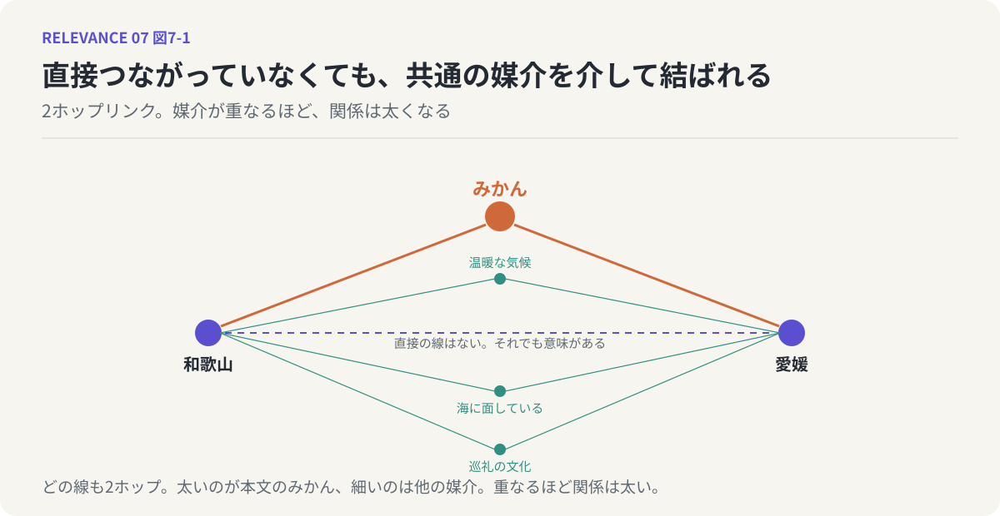
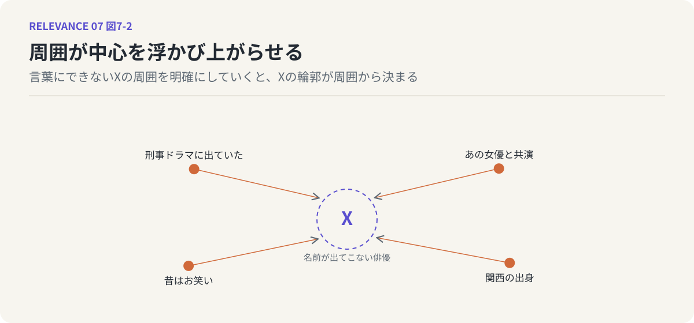

# 第7回　2ホップという回路 ── 関連の多重性

## 共通の媒介が関係をつくる

<!-- NAV:TOP -->
[← 第6回](06-ideas-as-finding-relations.md) | [連載目次](../README.md) | [第8回 →](08-generation-cheap-evaluation-expensive.md)
<!-- /NAV -->

和歌山県と愛媛県には、関係があるでしょうか。

本州と四国に分かれていて、直接は接していません。歴史的な因縁も特に思い浮かばない。前回の言葉で言えば、一見、関係なさそうに見える二つです。しかし「みかん」を思い浮かべた瞬間、様子が変わります。和歌山はみかんの産地として知られ、愛媛もみかんの産地として知られている。和歌山と愛媛は、みかんでつながっている。二つの間には、みかんという意味がある。

### 2ホップリンク

ここで起きたことを、少し形式的に書いてみます。AからCへの関係があり、BからCへの関係がある。このとき、AとBの間にも何らかの関係があると考えてよい。A、Bのどちらからも、Cを経由して一歩ずつ、合わせて二歩で相手にたどり着けるからです。この二歩のつながりを、2ホップリンク、略して2ホップと呼ぶことにします。

前回、「AとBの間には何がありますか」という問いの形を提案しました。2ホップリンクは、この問いへの答えの最も基本的な形です。間にあるのは、媒介です。AとBの両方に接している第三のもの。それが見つかれば、間は埋まります。

大事なのは、AとBが直接つながっている必要はない、ということです。和歌山と愛媛はみかんについて相談したことも、みかんを交換したこともないでしょう。それでも、どちらもみかんに向かって線を伸ばしているという事実だけで、二つの間に意味が生まれる。関係は、直接の接触がなくても、共通の相手を介して成立します。

*図7-1：和歌山と愛媛が「みかん」を共通の媒介として結ばれる2ホップリンク。細い線は気候や海など他の媒介で、重なるほど関係が太くなる。*

### 関連は多重的である

媒介は、ふつう一つではありません。和歌山と愛媛の間には、みかんのほかにも、温暖な気候、海に面していること、遍路や熊野のような巡礼の文化、など、いくつもの媒介が見つかります。媒介が一つなら、関係は細い。媒介が重なるほど、関係は太くなる。

これは第5回で見た「関係は分布である」という話と、きれいにつながります。関係の濃淡は、二点を結ぶ一本の線の太さではなく、二つの間にどれだけ多くの媒介が重なっているかで決まる。無数の2ホップが束になって、ぼやけた縁を持つ一つの意味の雲になる。関連は、本質的に多重的なのです。

### 周囲が中心を浮かび上がらせる

この回路は、意味を見出すだけでなく、意味をはっきりさせるためにも働きます。

名前が出てこない俳優のことを思い出そうとしている場面を考えてください。顔は浮かんでいる。しかし名前が出ない。そういうとき、わたしたちは周りから攻めます。あの刑事ドラマに出ていた。あの女優と共演していた。確か関西の出身で、昔はお笑いをやっていた。周囲の事柄を一つずつ明確にしていくと、あるところで、ふっと名前が出てくる。

ここでやっているのは、はっきりと言葉にできない何かXがあるときに、Xの周囲、つまりXと関係のあるものを明確化していく、という作業です。周囲が十分にそろうと、その真ん中にあるXの輪郭が、周囲から逆に決まってくる。消された地図の町でも、周りの道路と川を描き込めば、町のあった場所は分かります。関係が、意味を明確化するのです。

*図7-2：名前の出てこない俳優Xを、周囲の手がかりが取り囲んで浮かび上がらせる。周囲が十分にそろえば、真ん中の輪郭は周囲から決まる。*

### 根拠：すでに実装されている回路

2ホップリンクは、思いつきの比喩ではありません。グラフ理論の中で、確立された技術でもあります。

ウェブページの重要度を測るページランクという手法には、特定の出発点を決めて使う変種があります。出発点からリンクをたどってランダムに歩き回り、ときどき出発点に戻る。これを繰り返したとき、よく訪れることになるページは、出発点と関連が深いと見なせる。この手法は、直接リンクしていない二つのページの間にも、共通の媒介を介した関連の強さを確率として計算します。2ホップどころか、何ホップでも扱えます。[^page-brin][^jeh-widom]

最近では、この考え方がLLMそのものに組み込まれています。GraphRAGと呼ばれる枠組みは、文書から知識のグラフを作り、LLMが回答する際に、埋め込みの類似度だけでは拾えない間接的な関連情報を、媒介ノードを経由して掘り出します。第4回で見たように、類似度は歪んだ空間の中で測られているので、本当に関連するものを取りこぼすことがある。グラフを歩くことで、その取りこぼしを補う。これはもう仮説ではなく、アーキテクチャとして動いている事実です。[^edge-graphrag]

### 人も言葉も、同じ図の上に

わたし自身が関わっている試みの一つに、「関心空間」と呼んでいるものがあります。人と、その人が関心を持っているキーワードを、同じ図の上に並べる、という単純な構想です。

ここで起きることは、まさに2ホップです。ある人とあるキーワードが結ばれる。別の人も同じキーワードに結ばれる。すると、その二人の間に、直接の面識がなくても、関係が生まれます。逆に、一人の人が二つのキーワードに結ばれていれば、そのキーワード同士の間にも関係が生まれる。

やってみて分かったのは、「人」と「キーワード」を分けて扱う必要があまりない、ということです。ある人物の名前が、別の人たちの関心のキーワードになることは、ごく普通に起きます。人がキーワードになり、キーワードが人を結ぶ。すべてが同じ図の上のノードとして扱われ、共通の媒介を介して意味が伝わっていく。

### 鏡：LLMも脳もやっている

LLMは2ホップをやっている、とわたしは考えています。学習の過程で、直接一緒に現れたことのない二つの言葉でも、共通の文脈語を介して近い位置に置かれるようになる。みかんという語を共有する和歌山と愛媛が、モデルの中でも近づいているはずです。

そして人間の脳も、やっています。俳優の名前が周囲から浮かび上がってくるあの感覚は、2ホップの回路が動いている感覚そのものです。LLMの中で起きていることを逆再生すると、人間の連想の仕組みが、同じ形で見えてくる。

### 次回へ

媒介が多ければ多いほど、見出せる道筋は増えていきます。手元の要素が百あれば、それらの間に引ける2ホップの数は、もう数える気にならないほどになる。アイデアは組み合わせであり、組み合わせの数は爆発する。ならば、材料さえ集めればアイデアは出放題ではないのか。次回は、そうはならない理由を考えます。

## 参考文献・注記

[^page-brin]: Lawrence Page, Sergey Brin, Rajeev Motwani, Terry Winograd（1999）. [The PageRank Citation Ranking: Bringing Order to the Web](https://en.wikipedia.org/wiki/PageRank)。Stanford InfoLab Technical Report。リンク構造から重要度を計算する手法の原典。原文はStanfordのサーバーでhttpのみ公開されているため、リンク先は概念の紹介ページとした。
[^jeh-widom]: Glen Jeh, Jennifer Widom（2003）. [Scaling Personalized Web Search](https://doi.org/10.1145/775152.775191)。WWW 2003。出発点を固定したパーソナライズドPageRankの基礎。
[^edge-graphrag]: Darren Edge ほか（2024）. [From Local to Global: A Graph RAG Approach to Query-Focused Summarization](https://arxiv.org/abs/2404.16130)。Microsoft Research。知識グラフを検索拡張生成に組み込むGraphRAGの原論文。

<!-- NAV:BOTTOM -->
---

[← 第6回](06-ideas-as-finding-relations.md) | [連載目次](../README.md) | [第8回 →](08-generation-cheap-evaluation-expensive.md)
<!-- /NAV -->
