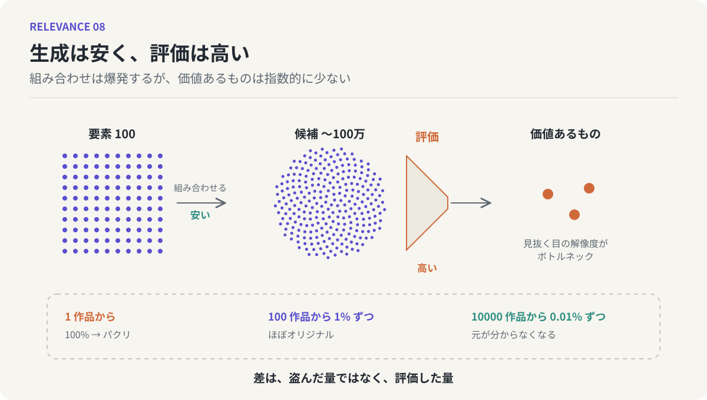

# 第8回　生成は安く、評価は高い

## 創造性のボトルネックの所在

<!-- NAV:TOP -->
[← 第7回](07-two-hop-links.md) | [連載目次](../README.md) | [第9回 →](09-retrieval-speed-and-a-b-or-c.md)
<!-- /NAV -->

手元にある要素が3個しかないとします。これらを組み合わせてできるものは、1個だけ使う場合から3個全部使う場合まで数えても、7通りにしかなりません。少ない。

では、先人の偉業や自然のメカニズムの面白いところを、100個くらい言葉にできているとしたらどうでしょう。その中から3つを選んで組み合わせると、組み合わせだけで16万通りを超え、並べる順番まで区別すれば100万通りに近づきます。アイデアが既存の要素の新しい組み合わせであるなら、材料が100個あれば、アイデアは100万個あることになる。

それなのに、「面白い発想が出なくて困っている」という人は、いつもいます。材料を集めれば解決するはずの問題が、解決していない。ここに何かがあります。

### ボトルネックは生成の側にはない

組み合わせの数が爆発すること自体は、創造性の制約ではありません。むしろ逆です。100万通りの組み合わせがあるとき、そのほとんどは価値のないものです。面白いもの、使えるものは、組み合わせの総数が増えるほど、割合としてはどんどん小さくなっていく。

すると、本当の課題は、組み合わせを作ることではなく、作られた組み合わせの中からどれが良いかを見分けることになります。100万個の候補を一つずつ試すことはできない。見分ける目の解像度が低ければ、良いものが目の前を通り過ぎても気づけない。創造性のボトルネックは、組み合わせを作る側ではなく、組み合わせの価値を見抜く側にあります。[^csikszentmihalyi]

*図8：左から右へ、要素を組み合わせて候補を生成する工程は安く、候補の中から価値あるものを見抜く評価の工程は高い。下段は、何作品から何パーセントずつ盗るかで、パクリとオリジナルの見え方が変わることを示す。*

### 感度の問題

面白い発想がなくて困っている人の本当の問題は、アイデアがないことではありません。世の中に溢れている素晴らしいアイデアへの感度が弱いことです。

これには、誰にでも覚えがあるはずです。人から素晴らしいアイデアを教えてもらったのに、その場ではその価値に気づけなかった。あとになって、別の誰かが同じことをやって成功しているのを見て、「あれは、あのとき聞いた話だ」と気づく。アイデアは目の前にあった。見抜けなかっただけです。

だから、アイデアが出せないことに困っている人がやるべきなのは、アイデアを出す練習ではなく、「面白い」と思うことの引き出しを増やすことです。引き出しが増えるというのは、材料が増えることでもありますが、それ以上に、面白さを感じ取る解像度が上がることです。

### てってーてきにパクる

面白い作品を作るための、少し乱暴な指針があります。1個の作品から盗ると、100パーセントのパクリになる。100個の作品から1パーセントずつ盗むと、ほぼオリジナルになる。10000の作品から0.01パーセントずつ盗ると、もう元の作品がどれだったか分からなくなる。[^kleon]

面白い発想を量産できる人を観察すると、だいたいこの指針どおりに動いています。自然や社会に溢れている要素を、常日頃から面白がっている。何かを作る必要が出てきたら、そのへんにあるものを組み合わせるだけで、いくらでも新しいものが出てくる。そういう人には、「ゼロから作る」という感覚がそもそもありません。材料はいつも手元にあり、組み合わせは無限にある。

### パクリと「格好良い」の違い

ここで一つ、疑問が出てくるはずです。10000から盗れば分からなくなる、というのは、ただ発覚しないだけではないのか。盗んでいることに変わりはないのではないか。

違いは、盗んだかどうかにはありません。選んだかどうかにあります。

パクリと呼ばれるものは、一つの源から、構造ごと持ってくる。そこに評価は働いていません。元の作品が面白かったという事実に乗っているだけで、何が面白いのかを見抜いて選んだわけではない。だから元の作品がすぐ透けて見える。媒介が一つしかない2ホップです。

一方、格好良いと感じられる借用は、多数の源から、それぞれの一番良いところだけを選び抜いています。この「選び抜く」が評価です。何を盗む価値があるかを見抜く目が、そこで働いている。そして選び抜かれた要素は、元の文脈から切り離されて、新しい関係の中に置かれる。第7回の言葉で言えば、別の作品から来た要素同士が、作り手の中で新しい媒介を介して結ばれる。元の作品が分からなくなるのは、隠しているからではなく、要素が本当に新しい関係の中に入ってしまったからです。

10000から盗る人と、1から盗る人の差は、盗んだ量ではなく、評価した量です。

### 鏡：安くなったのは生成だけ

LLMを鏡にします。LLMは、組み合わせを作ることを、劇的に安くしました。100個の要素を渡して「3つずつ組み合わせて提案して」と頼めば、一晩で何千という候補が出てきます。生成のコストは、ほとんどゼロに近づいている。

しかし、その何千の候補の中からどれが本当に面白いかを選び出す作業は、安くなっていません。LLMに評価を頼むこともできますが、「何を面白いと思うか」の基準そのものは、頼む側が持っていなければならない。基準のない人がLLMに評価させても、尤もらしい理由のついた、どれでもよい答えが返ってくるだけです。

生成は安くなり、評価は高いまま残った。これが、LLM以後の創造性をめぐる最も重要な非対称性だとわたしは考えています。生成のコストが下がった今こそ、選別の目が、差をつける唯一の場所になりつつある。

### 第II部の締めくくり

第II部では、関係を見出すという行為を追ってきました。関係は線ではなく分布であり、どの範囲を一塊と見るかで中にも間にもなる（第5回）。関係を見出すことがアイデアであり、見出された関係は仮説に過ぎない（第6回）。見出す回路の一つが2ホップであり、媒介が重なるほど関係は濃くなる（第7回）。そして、見出せる組み合わせがどれだけ増えても、ボトルネックは価値を見抜く側にある（第8回）。

### 次回へ

評価の目を鍛える、という話に進む前に、一つ手前の段階を見ておく必要があります。関係を見出したとして、それを頭の中から取り出して、言葉にするところで、多くのアイデアが消えているからです。「あ、関連するものがあったな」と思ってから、それを取り出すまでの時間。次回は、その時間の話から始めます。

## 参考文献・注記

[^kleon]: Austin Kleon（2012）. [Steal Like an Artist](https://austinkleon.com/steal/)。Workman。邦訳『クリエイティブの授業』実務教育出版。多数の源から借りることで独自性が生まれるという主張。
[^csikszentmihalyi]: Mihaly Csikszentmihalyi（1999）. [Implications of a Systems Perspective for the Study of Creativity](https://doi.org/10.1017/CBO9780511807916.018)。R. J. Sternberg (Ed.), Handbook of Creativity 所収。創造性を個人・領域・場の相互作用と見なし、場（評価する側）の役割を強調した。

<!-- NAV:BOTTOM -->
---

[← 第7回](07-two-hop-links.md) | [連載目次](../README.md) | [第9回 →](09-retrieval-speed-and-a-b-or-c.md)
<!-- /NAV -->
