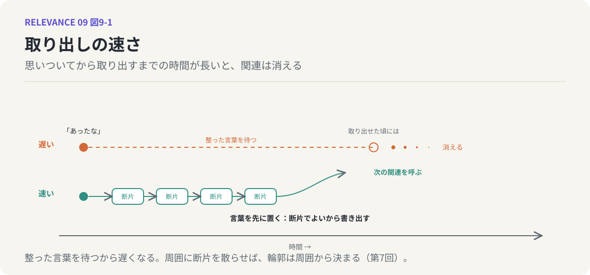
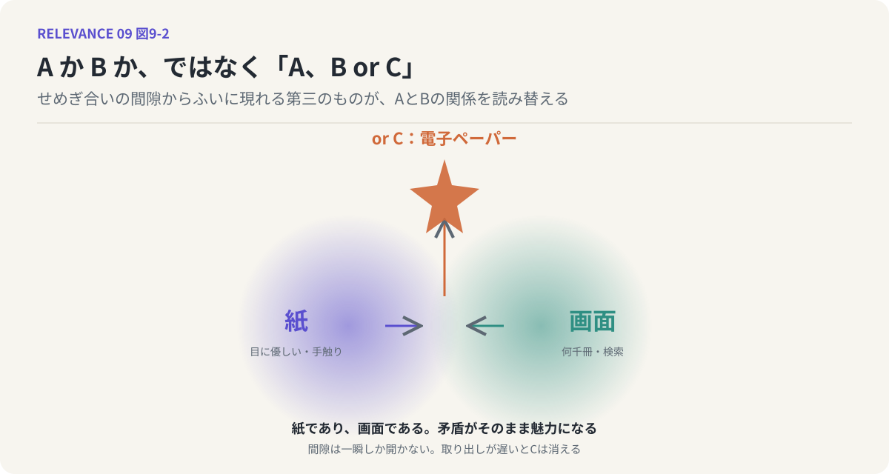
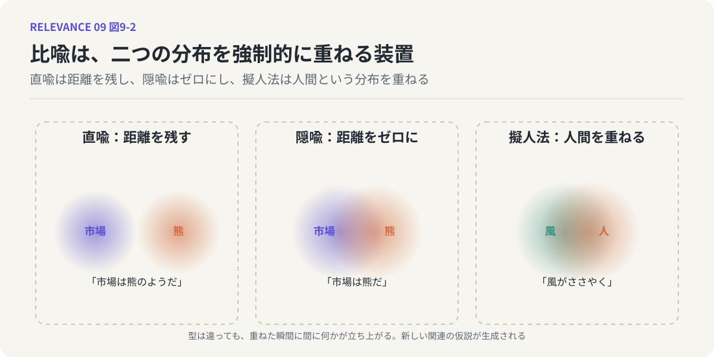

# 第9回　取り出しの速さ、そして「A、B or C」

## 言葉を先に置くこと、比喩という装置

<!-- NAV:TOP -->
[← 第8回](08-generation-cheap-evaluation-expensive.md) | [連載目次](../README.md) | [第10回 →](10-hallucination-and-creation.md)
<!-- /NAV -->

{.opener}

会議で誰かの話を聞いていて、「あ、それに関連するものがあったな」と思う。確かに何かあった。前に読んだ本か、別の案件で見た図か。しかし、それが何だったかを取り出そうとしているうちに話は先へ進み、取り出せたときにはもう発言の機会がない。あるいは、取り出せないまま会議が終わる。

関連するものは、あったのです。インプットが足りなかったわけではない。足りなかったのは、取り出す速さでした。

### 取り出しのコスト

第8回で、創造性のボトルネックは評価の側にあると述べました。今回は、その一歩手前に、もう一つ細い関所があることを見ておきます。見出した関係を、頭の中から外へ取り出すところです。

気づいてから実際に取り出すまでの時間のコストが高い状態だと、アウトプットにつながりません。思考は揮発しやすく、取り出しに時間がかかるあいだに別のことが上書きしてしまう。「あったな」という感覚だけが残り、中身は消える。

だから、関連づける力というのは、頭の中にどれだけ材料があるかだけでは決まりません。思いついてから取り出すまでの速さが、同じくらい効いてきます。速ければ、細い関連でも外に出て、次の関連を呼びます。遅ければ、太い関連でも消えます。

### 言葉を、先に置いてしまう

では、どうすれば速くなるのか。一つの答えは、整った言葉を待たないことです。

第6回で「AとBの間には何がありますか」という問いの形を提案しました。この問いに、一発できれいに整った言葉で答えようとするのは、無理があります。第3回で見たように、意味は点ではなく分布です。ぼやけた雲を、一語で正確に言い当てることは、原理的にできません。できないことを待っているから、取り出しが遅くなる。

ならば、断片的なキーワードの羅列でもよいから、まず書き出してしまう。きれいでなくてよい。間違っていてもよい。第7回で見たとおり、周囲が十分にそろえば、真ん中にあるものの輪郭は周囲から決まってきます。言葉を先に置くというのは、2ホップの媒介を手で並べていく作業です。

外に置くことには別の効用もあります。外に置かれた言葉は、他人と比べられる。自分が面白いと思ったことを書き出し、人の反応を見る。これを繰り返すと、自分の「面白い」の分布と世の中の分布のずれが見えてきます。ずれが見えれば、直せる。第8回の評価の目は、こうして育つのだと思います。

*図9-1：取り出しの速さ。整った言葉を待つと、取り出せた頃には関連は消えている。断片でよいから先に書き出せば、次の関連が呼ばれる。*

### A か B か、ではなく

言葉を先に置いていくと、ときどき奇妙なことが起きます。

AかBか、と二択で考えていたはずの場面で、AとBのせめぎ合いの間隙から、ふいに第三のものが現れる。AでもBでもない。しかし、AでありBでもあるような何か。これを「A、B or C」と呼ぶことにします。AかBかの二択ではなく、A、B、あるいはC。

紙か、画面か。本を読む手段をめぐって、長くこの二択が争われてきました。紙は目に優しく、めくる手触りがある。画面は何千冊でも持ち歩け、検索ができる。どちらを取るかという話だったところへ、電子ペーパーが現れます。紙のように反射光で読めて目が疲れず、画面のように中身を入れ替えられる。紙であり、画面である。AとBの矛盾をそのまま抱えたものが、AとBの争いの間隙から出てきて、しかもその矛盾こそが魅力になっている。

「or C」が現れると、AとBの関係そのものが読み替えられます。紙と画面は対立するものではなく、「読むための面」という一つの分布の、別々の端だったのだと分かる。新しい意味の創発とは、こういうことです。[^fauconnier-turner]

そして、「ふいに」という言葉に注意してください。間隙は一瞬しか開きません。取り出しが遅いと、Cは現れたことにも気づかれずに消えます。速さの話は、ここにつながっています。

*図9-2：「紙か画面か」という二択の間隙から、紙でも画面でもあり、どちらでもない第三のもの（or C）が現れる。*

### 比喩という装置

この創発を、わたしたちは実は日常的に起こしています。比喩です。

頭が固い。心が温かい。議論が白熱する。市場は熊だ。時は金なり。人生は旅だ。風がささやく。どれも、ある分布の上に、まったく別の分布を重ねています。[^lakoff-johnson]「頭」の上に「固さ」を、「市場」の上に「熊」を。重ねられた二つは、本来は何の関係もない。しかし重ねた瞬間、間に何かが立ち上がる。

比喩は言葉から言葉をつくる行為です。すでにある言葉を使って新しい言い方を作るのだから、二次創作的な営みと言ってよい。ところが同時に、比喩は多くの場合、最初に行われる行為でもあります。新しいものに最初につけられる名前は、たいてい借り物です。コンピュータの画面に開く「窓」、机の上を模した「デスクトップ」、増殖する「ウイルス」、電気の「流れ」。初めて現れたものを指す言葉がまだないとき、わたしたちは既存の分布を重ねて、仮の名前をつける。それがそのまま定着する。

比喩には型があります。「〜のような」と比較語を置く直喩は、二つの分布を近づけつつ、距離を少し残します。比較語を使わず「市場は熊だ」と言い切る隠喩は、距離をゼロにして、重ねてしまう。人間以外のものに人間の性質を与える擬人法は、人間という最も密で豊かな分布を、何にでも重ねられる万能の型です。型は違っても、やっていることは同じです。二つの分布を強制的に重ね、そこに新しい関連の仮説を生成する。比喩は、仮説を量産するための装置なのです。

*図9-3：比喩を、二つの分布を重ねる装置として描いた。直喩は距離を残し、隠喩は距離をゼロにし、擬人法は人間という分布を重ねる。*

この連載も、そうやって進んできました。砂の山、同じ方向を向いた群衆、意味の雲、面白さの引き出し。どれも比喩であり、どれも「意味」という掴みにくいものの上に、別の分布を重ねて輪郭を出そうとした試みです。

### 鏡：「ふいに」の値段

LLMを鏡にします。LLMには、取り出しの遅さがほとんどありません。関連するものは、問われた瞬間に出てきます。比喩も、頼めば何十でも並べてくれる。人間にとって希少で、一瞬しか開かない「ふいに」が、LLMにとっては無料に近い。

羨ましい性質ですが、ある結果を伴います。仮説が溢れるのです。関連を生成する装置がコストなしに動き続ける。人間なら取り出しの遅さが自然な歯止めになっていたところで、LLMには歯止めがない。

### 次回へ

仮説を量産する装置があるとして、外れた仮説はどうなるのでしょうか。第6回で、関連は検証されるまで仮説に過ぎないと述べました。検証を通らなかった仮説は、人間の場合、思いつきとして忘れられるか、作り話として楽しまれる。LLMの場合、それはハルシネーションと呼ばれます。次回は、この二つに境界があるのかを考えます。

## 参考文献・注記

[^lakoff-johnson]: George Lakoff, Mark Johnson（1980）. [Metaphors We Live By](https://press.uchicago.edu/ucp/books/book/chicago/M/bo3637992.html)。University of Chicago Press。邦訳『レトリックと人生』大修館書店。日常言語が比喩に貫かれていることを示した。
[^fauconnier-turner]: Gilles Fauconnier, Mark Turner（2002）. [The Way We Think: Conceptual Blending and the Mind's Hidden Complexities](https://www.basicbooks.com/titles/gilles-fauconnier/the-way-we-think/9780465087860/)。Basic Books。二つの概念空間を混合して新しい構造が創発する機構を論じた。

<!-- NAV:BOTTOM -->
---

[← 第8回](08-generation-cheap-evaluation-expensive.md) | [連載目次](../README.md) | [第10回 →](10-hallucination-and-creation.md)
<!-- /NAV -->
