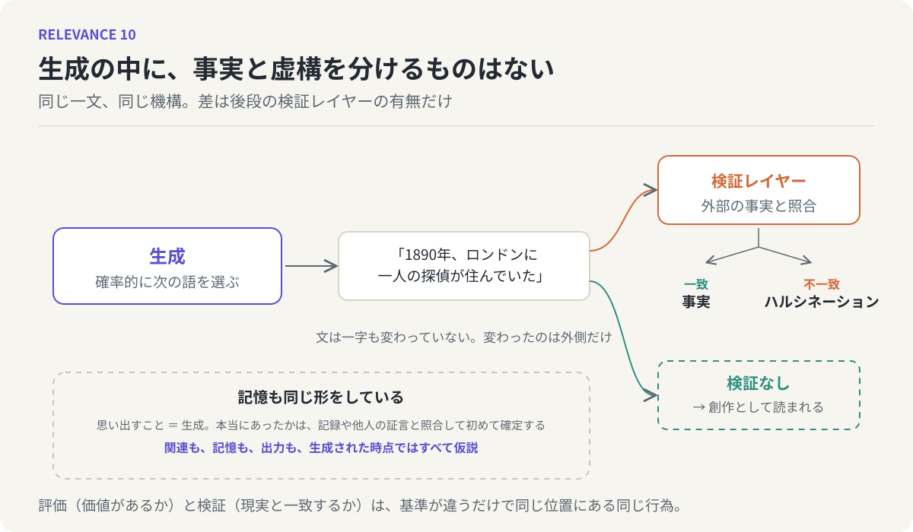

# 第10回　ハルシネーションと創作に境界はない

## 生成と検証、記憶と幻覚

<!-- NAV:TOP -->
[← 第9回](09-retrieval-speed-and-a-b-or-c.md) | [連載目次](../README.md) | [第11回 →](11-words-as-handles.md)
<!-- /NAV -->

境界は明確か。

第2回でこの問いを立てたとき、例に使ったのは青と緑でした。色相を少しずつずらしていっても、「ここから緑」という線は引けない。線があるように感じるのは、言葉のほうに輪郭があるからだ、という話でした。今回、同じ問いを別の場所に持ち込みます。ハルシネーションと創作の間に、境界はあるでしょうか。

### 同じ機構、同じ一文

ハルシネーションとは、LLMが事実でないことを、事実であるかのように尤もらしく出力してしまう現象を指す言葉です。存在しない論文を引用する。架空の人物の経歴を語る。嘘、でたらめ、幻覚。そう呼ばれて、LLMの欠陥として扱われています。[^ji]

しかし、LLMの中で何が起きているかを見ると、少し様子が変わります。第1回で述べたとおり、LLMは確率的に尤もらしい次の言葉を選び続ける装置です。この機構は、出力が事実に基づく記述であっても、完全な虚構であっても、まったく同一です。事実を書くときに別の回路が動き、虚構を書くときに別の回路が動く、ということはない。生成のプロセスの中には、事実と虚構を分けるものが何もありません。

一つの文を考えてみます。「1890年、ロンドンに一人の探偵が住んでいた」。この文が歴史の教科書に書かれていれば、裏づけが取れない限り、誤りと見なされます。LLMが出せば、ハルシネーションと呼ばれるでしょう。しかし同じ文が小説の冒頭に置かれていれば、それは創作です。誰も嘘だとは言わない。

文は一字も変わっていません。生成の仕方も変わっていません。変わったのは、その文の外側にあるものだけです。この文は現実と一致しているべきだ、という要求がかけられているかどうか。かけられていれば、一致を確かめる作業が後から行われ、一致しなければハルシネーションになる。かけられていなければ、確かめる作業は行われず、創作として読まれる。

ハルシネーションと創作を分けているのは、生成の後に外部の事実と照合する検証のレイヤーがあるかどうか、ただそれだけです。

*図10：生成の機構は一つで、出てくる文も同じ。外部の事実と照合する検証レイヤーを通れば事実かハルシネーションに分かれ、通さなければ創作として読まれる。下段は、同じ構造が人間の記憶にも当てはまることを示す。*

### 記憶も同じ形をしている

これはLLMに限った話ではありません。ケン・リュウの短篇「1ビットのエラー」に、記憶についての印象的な考察があります。[^liu]

わたしたちは、記憶がどう働くかについて、それなりに分かっているつもりでいる。しかし、実際に起こったことの記憶と、起こりえたが起こらなかったことの記憶、たとえばあとから思いついた当意即妙の返事を、まるで言ったかのように覚えている記憶と、そして起こりえるはずのないこと、日光が天使の目に反射して見えた、といった記憶とは、ニューロンのレベルでは同じ形で符号化されている。これらを区別するには、論理と理性、そして間接参照の層が必要になる。もしその区別がつかないなら、人は何でも信じさせられてしまう。おおよそ、そういう内容です。

ここで言われていることは、先ほどのLLMの話とぴたりと重なります。記憶の生成、つまり「思い出す」という行為そのものの中には、本当にあったことと、なかったことを分ける仕組みがない。分けるのは、後からかけられる論理と理性、そして記録や他人の記憶といった外部参照です。思い出すことと、作り出すことは、脳の中では同じ動作なのです。

### 関連は仮説に過ぎない、ふたたび

第6回で、関連は検証されるまで仮説に過ぎない、と述べました。この一文を、今回の文脈に置き直します。

記憶は、検証されるまで仮説に過ぎない。「思い出した」という感覚は、「生成した」という事実と区別がつきません。それが本当にあったことだと確定するのは、日記や写真や他人の証言と照らし合わせて、一致が取れたときです。照らし合わせる前の記憶は、どれほど鮮明でも、仮説です。

LLMの出力も同じです。「尤もらしい」という感覚は、「正しい」という事実と区別がつかない。確定するのは、外部の資料と照合して一致が取れたときです。照合する前の出力は、どれほど流暢でも、仮説です。

関連も、記憶も、出力も、生成された時点ではすべて仮説である。これがリフレインの、今回の変奏です。

### 評価と検証は同じ行為である

第8回で、創造性のボトルネックは生成ではなく評価にあると述べました。無数の組み合わせの中から、価値のあるものを見抜く目。そして今回、ハルシネーションと創作を分けるのは検証だと述べました。生成されたものを、外部の事実と照らし合わせる作業。

この二つは、別の名前で呼ばれていますが、構造は同じです。どちらも、生成の後段に置かれる。どちらも、生成されたものを、生成の外側にある基準と照らして選び分ける。評価は「価値があるか」という基準で、検証は「現実と一致するか」という基準で。基準が違うだけで、行為の位置と形は一致しています。

だから、生成は安く評価は高い、という第8回の非対称性は、そのまま今回にも当てはまります。生成は安く、検証は高い。LLMがハルシネーションを起こすのは、安い生成が高い検証を追い越してしまうからです。そして人間が記憶を捏造するのも、同じ理由です。

### 鏡：人間は毎日ハルシネーションしている

LLMを鏡にします。LLMのハルシネーションは、人間の記憶と想像の仕組みを、そのまま映し出しています。心理学の実験では、巧みに誘導された質問によって、体験していない出来事の記憶を人に植えつけることができると繰り返し示されてきました。[^loftus]植えつけられた記憶は、本物の記憶と同じ鮮明さと確信を伴います。本人には区別がつかない。外部の記録と照らし合わせるまで。

わたしたちは、LLMのハルシネーションを見て、機械の欠陥だと思います。しかしそれは、人間が自分自身の中で毎日起こしていることを、外に取り出して見せられているだけなのかもしれません。生成と検証が別の層にあり、生成だけが動いている状態。それが人間にとってどれほど日常的なことかを、LLMは逆再生して見せてくれています。

### 次回へ

ハルシネーションと創作の間に、生得的な境界はない。境界は、後からかけられる検証によって、事後的に引かれる。では、境界が後からしか引けないのなら、わたしたちは何を手がかりにして、ぼやけた分布としての意味を掴んでいるのでしょうか。生成の瞬間に、意味を掴むための取っ手になっているものは何か。次回は、その取っ手の話をします。

## 参考文献・注記

[^liu]: ケン・リュウ（2009）. [1ビットのエラー（Single-Bit Error）](https://en.wikipedia.org/wiki/Ken_Liu)。古沢嘉通訳。記憶の符号化と現実の区別に関する一節を本文で要約して引いた。リンク先は著者の紹介ページ。
[^loftus]: Elizabeth F. Loftus（2005）. [Planting misinformation in the human mind: A 30-year investigation of the malleability of memory](https://doi.org/10.1101/lm.94705)。Learning & Memory, 12(4)。虚偽記憶の植えつけに関する研究の総括。
[^ji]: Ziwei Ji ほか（2023）. [Survey of Hallucination in Natural Language Generation](https://doi.org/10.1145/3571730)。ACM Computing Surveys, 55(12)。LLMのハルシネーションの定義と分類に関する総説。

<!-- NAV:BOTTOM -->
---

[← 第9回](09-retrieval-speed-and-a-b-or-c.md) | [連載目次](../README.md) | [第11回 →](11-words-as-handles.md)
<!-- /NAV -->
