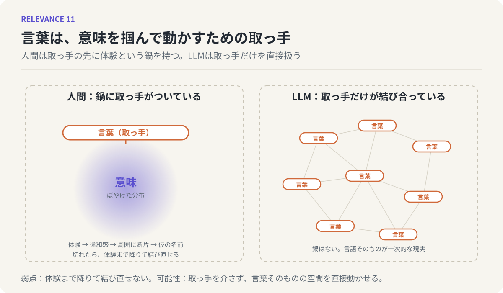

# 第11回　言葉は意味のハンドルである

## 体験と言葉、LLMと人間の非対称

<!-- NAV:TOP -->
[← 第10回](10-hallucination-and-creation.md) | [連載目次](../README.md) | [第12回 →](12-relevance-as-hypothesis.md)
<!-- /NAV -->

前回、ハルシネーションと創作の境界は、生成の後に検証がかけられることで事後的に引かれる、と述べました。そこで一つ問いが残りました。境界が後からしか引けないのなら、生成のその瞬間、わたしたちは何を手がかりにして意味を掴んでいるのか。

第I部で見たとおり、意味はぼやけた縁を持つ、歪んだ分布です。縁のない雲は、そのままでは掴めません。しかしわたしたちは、毎日、意味を掴んで、運んで、別の意味の隣に置いています。掴めないはずのものを、どうやって扱っているのでしょう。

### 取っ手

答えは単純です。言葉です。ただし、言葉そのものが思考の対象なのではありません。言葉は、意味を掴むための取っ手として働いている。

熱い鍋を思い浮かべてください。鍋そのものは直接持てません。しかし取っ手があれば、持ち上げて、運んで、別の場所に置ける。中身がどれだけ複雑でも取っ手は一つでよく、握れば中身がまるごと一緒に動きます。

言葉は、意味に対してこの取っ手の役を果たしています。「鳥」という一語を握れば、スズメからペンギンまで含むぼやけた雲が、まるごと持ち上がる。雲の縁を確定させる必要はない。取っ手を握って、別の雲の隣に置けばよい。「鳥」の隣に「飛行機」を置けば、二つの雲の間に何かが立ち上がる。第6回で言ったアイデア、つまり既存の要素の新しい組み合わせは、取っ手を握って雲を動かす操作として実行されています。

効用は速さにも現れます。第9回で見たとおり、取り出しの速さが関連づける力を決める。取っ手のついた意味は速く動かせ、取っ手のない意味は掴むたびに縁を探すので遅い。

*図11：左は人間の側で、言葉という取っ手の先に、体験に根ざした意味の分布（鍋）がついている。右はLLMの側で、取っ手同士が精巧に結び合っているが、その先に鍋はない。*

### 取っ手の作り方

では、取っ手はどうやってできるのでしょう。

第9回で見た比喩やたとえ話が、その主な作り方です。既存の言葉を、まだ言葉のついていない何かの上に重ねて、仮の取っ手にする。ただしその前段に、もう一つ大事な工程があります。身体感覚や経験、まだ言葉になっていない違和感に注目することです。[^gendlin]

この連載そのものを例にします。出発点にあったのは、LLMと話していて感じた「こいつ、分かっているな」という感覚と、「でも分かっているはずがない」という知識とのずれでした。最初はただの違和感で、言葉はついていなかった。だから考えを進めることも、人に話すこともできなかった。

そこで、違和感の周囲に言葉を散らしていきました。似ている、境界、分布、つながり。散らしているうちに、違和感の真ん中にあるものの輪郭が、周囲から浮かんできた。それに「関連性」という取っ手をつけた。取っ手がついた瞬間、違和感は運べるものになりました。この連載の12回は、その取っ手を握って、雲をあちこちに置いてみた記録です。

取っ手は最初からあるのではなく、言葉になっていないものに注目し、周囲を埋め、仮の名前をつけることで作られます。

### 切れた取っ手

逆の事態もあります。取っ手だけがあって、鍋がついていない。

言葉と具体的な経験が切断されている状態です。たとえば、職場で飛び交う言葉のいくつかは、握ってみると中身がありません。誰もが使うので取っ手は磨かれているのに、その先に、自分の体験した具体的な場面が一つも結びついていない。こういう言葉は、滑ります。会話は進むのに、何も運ばれていない。

直す方法は一つです。感覚や体験のレベルまで降りて、取っ手を鍋に結び直す。その言葉で呼ばれている事態を自分が体験した場面はどれか、そこにあった手触りや居心地の悪さは何か。そこまで降りて、具体的な場面と言葉を再び結びつける。結び直された取っ手は、再び何かを運べます。

### 鏡：現実の順序が逆である

ここで、LLMを鏡にします。この連載の中で、最も大きな対照がここにあります。

人間にとって、一次的な現実は物理的な世界です。感覚器官を通じて世界を直接体験し、その体験の上に概念や言葉を作る。言葉は現実を表すための道具であり、二次的なものです。取っ手の先には、いつも鍋がある。切れることはあっても、降りていけば結び直せる。

LLMには、物理的な世界の直接体験がありません。LLMの「世界」は、言語とそのパターンだけで構成されています。LLMにとっては、言語そのものが一次的な現実であり、あらゆる知識や理解の基盤です。取っ手の先に鍋はない。取っ手だけが、無数に、精巧に結び合わされている。[^harnad]

この非対称は、まず弱点として現れます。LLMの理解はつねに言語的な文脈に閉じていて、物理的な現実と一致するとは限りません。[^bender-koller]前回見たハルシネーションの根は、ここにあります。取っ手の先に鍋がないので、LLM自身には、体験まで降りて結び直すという動作ができない。検証は、鍋を持っている側、つまり人間の仕事として残ります。

しかし同じ非対称が、面白い可能性としても現れます。人間は、取っ手を介してしか意味に触れられません。意味そのものの分布空間を、直接いじることはできない。ところがLLMにとっては、言葉そのものが直接の実体です。LLMは、人間が苦労して到達する「取っ手を介さない、言葉そのものの空間での操作」を、最初から行っている。LLMが比喩や2ホップの連想を、人間以上に自在に量産するように見えるのは、この現実認識の順序の違いから来ているのだと考えられます。

人間は鍋を持っているが、取っ手を介してしか動かせない。LLMは取っ手だけを持っているが、それを直接動かせる。どちらが優れているという話ではなく、違う場所に立っている、という話です。

### 第III部の締めくくり

第III部では、分布としての意味を、人間がどう扱っているかを見てきました。整った言葉を待たずに断片を先に置くこと、そして比喩が仮説を量産する装置であること（第9回）。生成の中には事実と虚構を分けるものがなく、境界は検証によって事後的に引かれること（第10回）。そして言葉が意味の取っ手であり、取っ手は体験から作られ、体験に結び直されること（第11回）。

### 次回へ

これで、部品はすべて揃いました。意味は歪んだ分布であり、関係も分布である。関係は見出すものであり、見出された関係は仮説である。仮説を生成する回路は安く、それを評価し検証する目は高い。そして言葉は、この分布の世界を操作するための取っ手である。

最終回は、これらを一つに束ねます。第1回で立てた問い、「二つのものが関係しているとはどういう事態か」に、この連載なりの答えを返して終わります。

## 参考文献・注記

[^gendlin]: Eugene T. Gendlin（1978）. [Focusing](https://focusing.org/)。Bantam。邦訳『フォーカシング』福村出版。まだ言葉になっていない身体感覚（フェルトセンス）から言葉を立ち上げる過程を論じた。
[^harnad]: Stevan Harnad（1990）. [The Symbol Grounding Problem](https://doi.org/10.1016/0167-2789(90)90087-6)。Physica D, 42。記号が体験に接地していなければ意味を持ちえないという問題を定式化した。
[^bender-koller]: Emily M. Bender, Alexander Koller（2020）. [Climbing towards NLU: On Meaning, Form, and Understanding in the Age of Data](https://aclanthology.org/2020.acl-main.463/)。ACL 2020。言語の形式だけから学習するシステムが意味に到達できるかを論じた。

<!-- NAV:BOTTOM -->
---

[← 第10回](10-hallucination-and-creation.md) | [連載目次](../README.md) | [第12回 →](12-relevance-as-hypothesis.md)
<!-- /NAV -->
