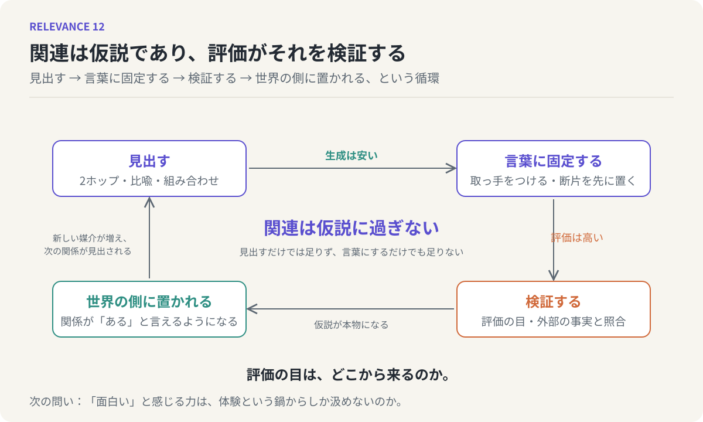

# 第12回　関連は仮説であり、評価がそれを検証する

## 全体の統合と、次の問い

<!-- NAV:TOP -->
[← 第11回](11-words-as-handles.md) | [連載目次](../README.md)
<!-- /NAV -->

第1回で、この連載はただ一つの問いに絞ると宣言しました。二つのものが「関係している」とは、どういう事態なのか。11回かけて部品を揃えてきたので、最終回はそれらを束ねて、この問いに答えを返します。要約ではなく、一本の論として通してみます。

### 意味の形から

出発点は、意味の形でした。「AとBは似ている」と言うとき、わたしたちは二点を結ぶ線を思い描きますが、線の両端にあるはずの点が、そもそも点ではなかった。意味は点でも、境界を持つ集合でもなく、ぼやけた縁を持つ分布です。中心に典型例があり、縁へ向かって薄くなり、どこまで行っても完全には消えない。スズメは中心に、ペンギンは裾にいる。

しかもその分布は四方へ均等に広がってはいません。言語モデルの内部では、意味のベクトルは狭い円錐に偏って密集し、この歪みのために無関係なものが近く見える。「似ている」が揺れるのは、測られる側に境界がないからだけでなく、測る側の空間が曲がっているからでもあります。

### 関係もまた分布である

意味が分布なら、二つの意味の「間にある関係」も線ではありえません。海と夏の関係を挙げていけば、それ自体がひとつの意味の雲になる。関係は意味であり、意味は分布であり、ゆえに関係も分布です。

ここから、「中にある」と「間にある」の両立が出てきました。大阪と京都の間にあるものは、関西の中にあるものでもある。どの範囲を一塊と見るかの違いに過ぎない。階層をなす意味が素直に収まるのは、外へ向かって指数関数的に広がる双曲空間で、そこでは近いことと包含されていることが同時に成り立ちます。

### 関係は見出される

関係が線ではなく、見る側の範囲の取り方で現れたり消えたりするものなら、関係は最初から「あるかないか」が決まっているものではなく、見出されるものです。そして見出すことには、すでにアイデアという名前がついていました。アイデアとは既存の要素の新しい組み合わせであり、組み合わせるとは、まだ結ばれていない二つの分布の間に関係を見出すことです。

見出す回路の一つが、2ホップでした。和歌山と愛媛は、みかんという共通の媒介を介して結ばれる。媒介は重なるほど関係を太くし、無数の2ホップの束が関係の雲を作る。この回路はグラフ上の計算としてすでに実装され、人間の脳も、名前の出ない俳優を周囲から思い出すとき、同じ回路を回しています。

### 関連は仮説に過ぎない

しかし、見出された関係は、その瞬間に本物になるわけではありません。ゴボウの実と留め具の関係は、何年もの試作を経て面ファスナーになったときに本物になった。血液型と性格の関係は、多くの人が信じて行動したのに、検証の段階で消えた。検証される前の関連は、どれほど確信があっても、仮説です。

この一文は、記憶にも、LLMの出力にも当てはまりました。思い出すことと作り出すことは脳の中では同じ動作で、LLMが事実を書くときと虚構を書くときも機構は同一です。ハルシネーションと創作を分けるのは、後段の検証の有無だけでした。第2回で立てた「境界は明確か」という問いへの答えは、こうなります。境界は生成の中にはなく、検証によって事後的に引かれる。

### 生成は安く、評価は高い

ここで、創造性のボトルネックの所在が見えてきます。材料が百あれば組み合わせは百万近くになりますが、価値のあるものはその中で指数的に少ない。見出すこと、生成することは、本質的に安い。高いのは、無数の候補の中から価値あるものを見抜く評価の目と、見出された関係が現実と一致するかを照らす検証の層です。そして評価と検証は、名前が違うだけで、生成の後段で外部の基準と照らして選び分けるという同じ行為でした。

LLMは、生成をほとんど無料にしました。取り出しの遅さという人間の自然な歯止めもなく、比喩も2ホップも量産する。だから仮説が溢れる。安い生成が高い検証を追い越したとき、ハルシネーションが起きる。人間が記憶を捏造するのも同じ理由です。生成は安く、評価は高い。これがLLM以後の創造性をめぐる、最も重要な非対称性だとわたしは考えています。

### 言葉という取っ手

最後の部品は、言葉でした。縁のない分布はそのままでは掴めず、言葉はその雲を掴んで動かすための取っ手です。取っ手は、まだ言葉になっていない違和感の周囲に断片を散らし、浮かんできた輪郭に仮の名前をつけることで作られます。整った言葉を待たずに断片を先に置くのは、取っ手を作る作業そのものです。

人間にとって、取っ手の先にはいつも体験という鍋がついています。LLMには鍋がなく、取っ手だけが精巧に結び合わされている。だからLLMには体験まで降りて結び直すことができず、検証は人間の仕事として残る。しかし同時に、LLMは取っ手を介さず言葉そのものの空間を直接動かせる。鍋を持つ者と、取っ手を直接扱える者。立っている場所が違う。

*図12：連載全体を一つの循環として描いた。関係を見出し、言葉に固定するまでの生成は安く、検証する評価は高い。検証を通った関係だけが世界の側に置かれ、新しい媒介となって次の関係を見出す足場になる。*

### 答え

問いに戻ります。二つのものが「関係している」とは、どういう事態か。

それは、二つの分布の間に、媒介の束からなる第三の分布が立ち上がっている状態です。その分布は、見る側がどの範囲を一塊とするかによって中にも間にもなり、「現時点では」という時間の指標を含み、見出された時点では仮説であり、行動による検証を経て初めて「ある」と言えるようになる。関係は、世界の側に最初から置かれているものではなく、見出され、言葉で固定され、検証されることで、事後的に世界の側へ置かれていくものです。

だから、関連性を見出す力とは、こう言い直せます。分布としての意味の中に、まだ言語化されていない道筋を見つけ出し、それを検証可能な仮説として言葉に固定する力。見つけるだけでは足りず、言葉にするだけでも足りない。検証できる形にまで持っていくところまでが、この力の範囲です。

### 鏡を見終えて

この連載は、LLMの振る舞いから人間を逆再生する、という方法で進めてきました。12回分の鏡を見終えて分かったのは、人間とLLMが、同じ場所でつまずき、同じ回路で見出し、同じように仮説を溢れさせている、ということです。違いはただ一つ、取っ手の先に鍋があるかどうかでした。先行するモデルが本質を暗示する、という第1回の見立ては、少なくともこの問いについては、空振りではなかったと思います。

### 次の問い

一つ、問いを残して終わります。生成が安くなり、評価だけが高いまま残るのなら、その評価の目は、どこから来るのでしょうか。「面白い」と感じる力は、何でできているのか。それは体験という鍋からしか汲めないものなのか、それとも取っ手だけの世界からも立ち上がりうるのか。LLMに評価をさせたとき何が起きるかを逆再生すれば、また別のものが見えてくるはずです。それは、次の連載の問いになります。

<!-- NAV:BOTTOM -->
---

[← 第11回](11-words-as-handles.md) | [連載目次](../README.md)
<!-- /NAV -->
