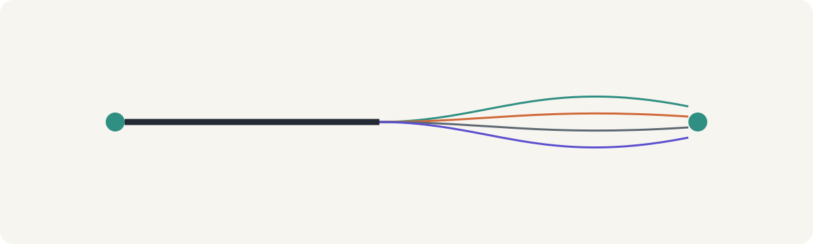
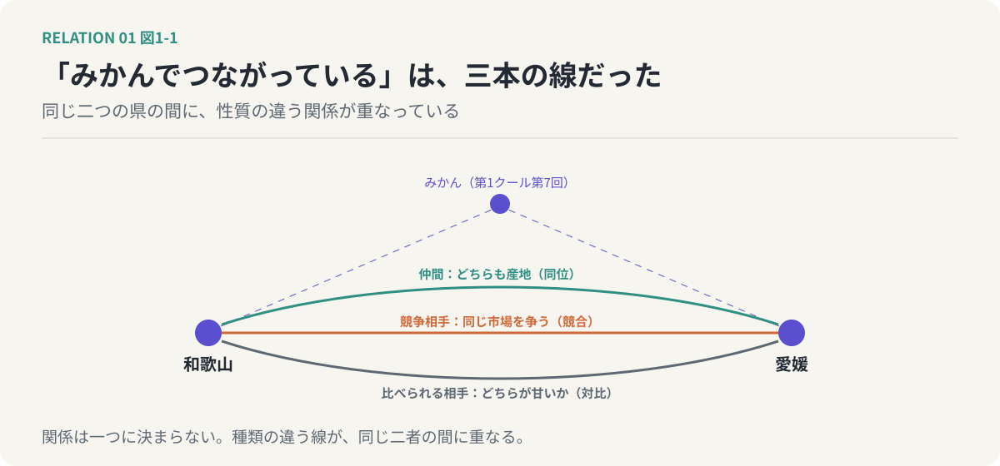
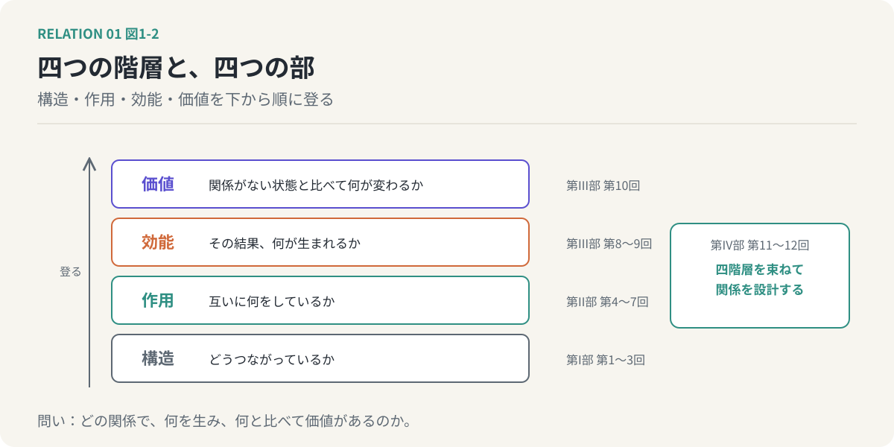
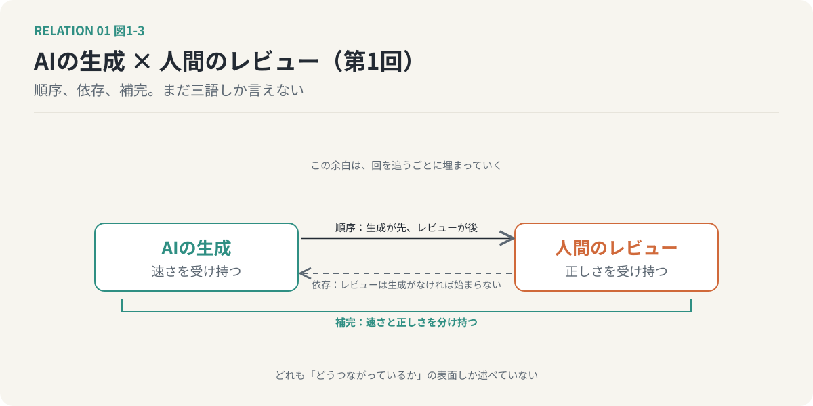

# 第1回　「関係がある」は、いくつもの関係の重なりである

## 関係は一つに決めない。第2クールの見取り図と、共通例の導入

<!-- NAV:TOP -->
[連載目次](../README.md) | [第2回 →](02-meaning-and-structure.md)
<!-- /NAV -->

{.opener}

第1クールの第7回で、和歌山県と愛媛県の話をしました。本州と四国に分かれ、直接は接していない二つの県が、「みかん」という共通の媒介を介して結ばれている。あのとき、わたしは「和歌山と愛媛は、みかんでつながっている」と書いて、それで済ませました。

今になって読み返すと、この「つながっている」が、ずいぶん粗い言い方だったことに気づきます。どうつながっているのでしょうか。どちらもみかんの産地である、という意味なら、二つは「同じ仲間」です。同じ市場でみかんを売っている、という意味なら、二つは「競争相手」です。テレビの番組で「和歌山のみかんと愛媛のみかん、どちらが甘いか」と並べられるなら、二つは「比べられる相手」です。仲間、競争相手、比べられる相手。どれも「みかんでつながっている」のに、関係の性質はまるで違います。

### 第1クールが一つにしていたもの

第1クールでは、関係を一つのぼやけた塊として扱いました。意味は分布であり、関係もまた分布である。関連は仮説に過ぎず、評価がそれを検証する。この見方は、関係が「あるかないか」という問いに答えるには十分でした。

しかし、関係が「ある」と分かったあとで、それがどんな関係なのかを問いはじめると、塊のままでは手に負えなくなります。和歌山と愛媛の関係の雲をよく見ると、その中には性質の違う何本もの線が走っている。仲間であるという線、競争相手であるという線、比べられるという線。それぞれは別の種類の関係で、別のことを教えてくれます。

第2クールは、この塊をほどくところから始めます。

*図1-1：第1クール第7回で「みかんでつながっている」と書いた二つの県の間には、同じ産地という同位、同じ市場を争う競合、どちらが甘いかと比べられる対比、という性質の違う三本の線が重なっている。*

### 関係の種類は、二十ほどある

二つのものの関係を、どんな種類に分けられるか。試しに挙げてみます。同じである。似ている。違う。対立する。補い合う。一方が他方を含む。一方が他方の部品である。一方が他方に依存する。一方が他方を引き起こす。一方が先に起きる。一方が他方の手段である。一方が他方を制限する。同じ資源を争う。一方が他方に変わる。そして、互いに影響しない。

数えればざっと二十ほどになります。一つずつ覚えてもらうつもりはありません。見てほしいのは、種類の多さではなく、これらが互いに排他的ではない、という事実です。

親と子を考えてください。親は子を養うので、子は親に依存しています。子は親の性質を受け継ぐので、二人の間には継承の関係があります。家族という単位で見れば、子は家族という全体の部分です。思春期になれば、二人は対立します。依存、継承、全体と部分、対立。どれも同時に成り立っていて、どれか一つを選んで「親子とはこういう関係だ」と言うことはできません。

AとBが似ていながら、同時に競合している。AがBを含みながら、同時にBに依存している。関係を一つに決めようとすると、必ず何かがこぼれます。関係は、一つではない。これが第2クールの最初の主張であり、何度か戻ってくることになるリフレインです。

### 一本の問い

第2クールを貫く問いを、一つに絞ります。

**二者のあいだに「関係がある」と言うとき、それはどの関係で、何を生み、何と比べて価値があるのか。**

三つの部分に分かれています。どの関係か。何を生むか。何と比べて価値があるか。この三つは順に深くなります。種類を分けられると、その関係から何が生まれるかが問える。何が生まれるかが分かると、関係がなかった場合と比べて何が変わったのか、つまり価値が問える。

もう少し整理すると、関係は四つの階層で記述できます。どうつながっているかという**構造**。互いに何をしているかという**作用**。その結果、何が生まれるかという**効能**。そして、関係がない状態と比べて何が改善し、何が悪化したかという**価値**。構造、作用、効能、価値。第2クールは、この四階層を下から順に登っていきます。

### 第1クールの最後の問いを引き継ぐ

第1クールの最終回で、一つの問いを残しました。生成は安くなり、評価だけが高いまま残るのなら、その評価の目はどこから来るのか。

第2クールは、この問いに正面から答えるものではありません。しかし、四階層の一番上まで登ったとき、部分的な答えが見えてくるはずです。評価とは、関係がある世界と、関係がない世界を比べることだ。この比較を、反実仮想と呼びます。第10回で、そこまで行きます。

### 連載の見取り図

全12回を四つの部に分けます。

第I部（第1回〜第3回）では、「関係がある」をほどきます。関係の意味と、関係の構造的な性質を分け、取り違えやすい関係の組を区別します。

第II部（第4回〜第7回）では、関係の種類を四つの群に分けて、一回に一群ずつめぐります。見比べる関係、役割の関係、時間の中の関係、そして意味の関係です。群ごとに、見えるようになるものが違います。

第III部（第8回〜第10回）では、関係が何を生むかを問います。関係の種類と、関係から生まれる効能を混同しないこと。効能には条件と時期があること。そして、関係の価値は、関係がなかった場合との差でしか測れないこと。

第IV部（第11回〜第12回）で、関係そのものを知識として持ち、設計の対象にするところまで行きます。個々の対象の性能ではなく、対象と対象の間を設計する。それがこの連載の到達点です。

*図1-2：第2クールの見取り図。関係は、どうつながっているかという構造、互いに何をしているかという作用、その結果何が生まれるかという効能、関係がない状態と比べて何が変わるかという価値の四階層で記述でき、連載はこれを下から順に登る。*

### 適用：AIの生成と、人間のレビュー

第2クールでは、毎回の終わりに、同じ一組の例に、その回で手に入れた道具を当ててみます。AIがコードを生成し、人間がそれをレビューする、という一組です。ソフトウェア開発に寄った例ですが、二つの対象が互いに作用して全体の成果を左右する点で、この連載の問いにちょうど収まります。回を追うごとに、この一組の記述が厚くなっていくはずです。

第1回の時点で言えることは多くありません。生成が先でレビューが後、という順序がある。レビューは生成されたものがなければ始まらないので、依存している。生成が速さを、レビューが正しさを受け持つので、補い合っている。順序、依存、補完。今はこの三つを並べるだけにします。三つが同時に成り立っていること、そしてどれも「どうつながっているか」の表面しか述べていないことを、覚えておいてください。

*図1-3：共通例の第1回版。生成とレビューの間に、順序、依存、補完の三本を引いただけの状態。箱の上下と右の余白は、回を追うごとに埋まっていく。*

### 次回へ

関係は一つではなく、重なりである。では、重なっている一本一本を、どうやって見分ければよいのでしょうか。手がかりは二つあります。「何によって結びついているか」と、「どういう形でつながっているか」。似ているという関係は、AからBへ向いているのでもBからAへ向いているのでもなく、向きがありません。含むという関係には、向きがあります。次回は、この「何の関係か」と「どうつながるか」を、別々の軸として取り出します。

<!-- NAV:BOTTOM -->
---

[連載目次](../README.md) | [第2回 →](02-meaning-and-structure.md)
<!-- /NAV -->
