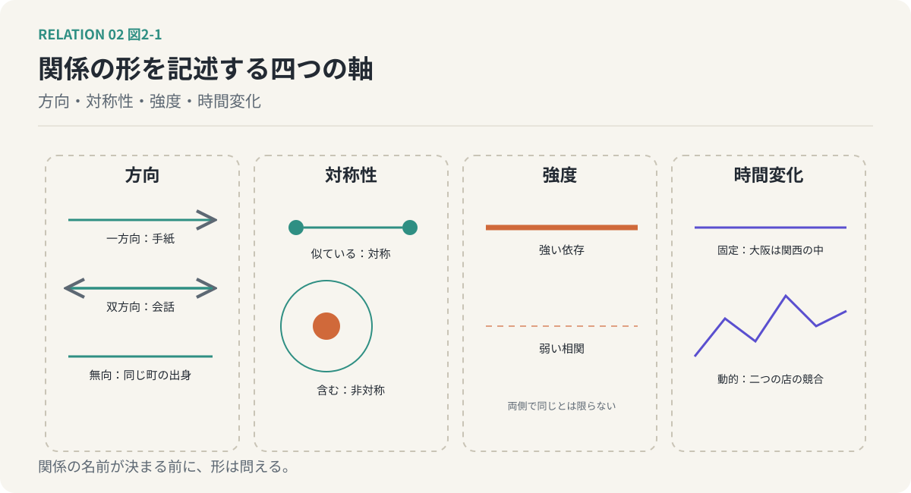

# 第2回　「何の関係か」と「どうつながるか」を分ける

## 方向・対称性・強度・時間変化という四つの軸

<!-- NAV:TOP -->
[← 第1回](01-relations-overlap.md) | [連載目次](../README.md) | [第3回 →](03-five-distinctions.md)
<!-- /NAV -->

「AはBに似ている」と言えば、「BはAに似ている」も言えます。どちらから言っても同じです。ところが「AはBを含む」と言ったとき、「BはAを含む」は言えません。向きが決まっている。

似ているも、含むも、第1回で挙げた関係の種類の一つです。どちらも「関係がある」と言えるのに、形が違う。一方には向きがなく、他方には向きがある。種類が違うから形が違う、と片づけることもできます。今回は逆の順序で考えます。形のほうを先に取り出して、種類とは別の軸として扱ってみる。

### 二つの問い

二つのものの関係について、問いは二つに分けられます。

一つは、**何によって結びついているか**。共通の性質か、原因と結果か、部品と全体か、同じ資源の奪い合いか。第1回で二十ほど挙げたのは、この問いへの答えの一覧でした。これを関係の意味と呼ぶことにします。

もう一つは、**どういう形でつながっているか**。向きはあるか。両側から同じことが言えるか。どれくらい強いか。時間とともに変わるか。これを関係の構造と呼ぶことにします。

この二つは別の軸です。同じ意味でも形が違うことがあり、同じ形でも意味が違うことがある。そして意味の種類は増え続けるのに対して、形を記述する軸は数本で足ります。

### 方向

まず、向き。関係には、一方から他方へ向かうもの、両方から向かい合うもの、向きのないものがあります。

手紙は、書いた人から受け取る人へ向かいます。会話は、両方から向かい合います。同じ町の出身だという関係には、向きがありません。先ほどの「含む」は一方向で、「交換する」は双方向、「似ている」は無向です。

向きは、関係の名前を知らなくても問えます。AとBの間に何かがあるらしい、という段階でも、「AからBへ流れているのか、戻ってくるのか、流れていないのか」と問える。だから向きは、関係をほどく最初の手がかりになります。

### 対称性

次に、対称性。AからBへ言えることが、BからAへも言えるか。似ているは対称で、含むは非対称です。

向きと対称性は近い概念ですが、同じではありません。双方向なのに非対称、という関係があるからです。友人関係を考えてください。連絡は双方向に流れています。しかし、片方がもう片方を頼りにしている度合いは、たいてい同じではない。一方にとっては何人もいる友人の一人で、他方にとっては唯一の相談相手、ということはよくあります。流れは双方向で、立場は非対称。この食い違いを見落とすと、関係の見立てを誤ります。

### 強度

三つめは、強さ。強い依存と弱い相関。固い結びつきと、かすかな連動。

第1クールで、意味は濃淡を持つ分布だと述べました。関係も同じで、あるかないかではなく、どれくらい強いかで記述できます。そして強度は両側で同じとは限りません。先ほどの友人関係の非対称は、向きではなく強度の非対称でした。AからBへの依存は強く、BからAへは弱い。向き、対称性、強度を別々に見るから、こう言えます。

### 時間変化

四つめは、時間。関係は固定されているか、動いているか。

大阪が関西の中にあるという包含は、動きません。二つの店が同じ客を奪い合うという競合は、一方が閉店すれば消えます。関係は時間の中で、強まり、弱まり、向きが反転し、消滅します。第1クールの第6回で「現時点では関係なさそう」という言い方をしましたが、あれは関係が時間の関数だということを先取りしていたのだと、今なら言えます。

*図2-1：関係の形を記述する四つの軸。方向は一方向・双方向・無向、対称性は両側から同じことが言えるか、強度は結びつきの強さで両側で同じとは限らず、時間変化は固定か動的か。*

### おまけの軸：推移性

四つの軸に、もう一つだけ足しておきます。AとBの間に成り立ち、BとCの間にも成り立つ関係が、AとCの間にも成り立つか。これを推移性と呼びます。

含むは推移します。大阪は関西に含まれ、関西は日本に含まれるので、大阪は日本に含まれる。ところが、似ているは推移しません。第1クールの第5回で見た家族の顔を思い出してください。目は父に似て、鼻は母に似ている。父と母は似ていない。AはBに似て、BはCに似ていても、AがCに似ている保証はない。

家族的類似という第1クールの言葉を、今回の言葉で言い直すと、こうなります。似ているという関係は、対称だが、推移しない。同じであるという関係は、対称で、かつ推移する。たったこれだけの形の違いが、「全員に共通する一つの特徴はないのに家族だと分かる」という現象を生んでいたのです。

### なぜ分けるのか

意味と構造を分けると、二つのことができるようになります。

一つは、関係の名前が決まる前に形を問えることです。「何の関係か」を決めるには時間がかかります。「向きはあるか」「どちらが強く頼っているか」「動いているか」は、名前が決まる前に答えられる。関係という仮説を立てる前に、仮説の形を先に書き出せる。

もう一つは、意味の違う関係同士を比べられることです。依存と競合は、意味としてはまったく別の関係です。しかし「有向で、非対称で、強く、動的」という形は共有しうる。形が同じなら、同じ手の打ち方が効くかもしれない。この見立ては、第IV部で関係を設計の対象にするときに効いてきます。

### 適用：AIの生成と、人間のレビュー

第1回では、生成とレビューの関係を「順序、依存、補完」と三つ並べました。今回の四つの軸を当ててみます。

方向。生成されたコードはレビューへ流れるので、一見すると一方向です。しかしレビューの指摘は生成側へ戻り、次の生成を変えます。流れは双方向です。この戻りの流れが何を起こすかは、第6回で扱います。

対称性。非対称です。レビューは生成されたものがなければ始まりませんが、生成はレビューがなくても動きます。依存の向きが片側に偏っている。

強度。生成されたコードの欠陥率が高いほど、全体はレビューに強く依存します。欠陥率が低ければ、依存は弱い。強度は固定の値ではなく、生成の質という別の量に連動しています。

時間変化。生成量が増えれば、レビューにかかる負荷が変わり、関係の強度も変わります。この関係は恒常ではなく、動いている。

第1回で挙げた順序、依存、補完という三つの意味は、同じ一つの形を共有していました。双方向で、非対称で、生成の質に連動し、量とともに動く。意味は三つでも形は一つで書けた。これが、意味と構造を分けたことの最初の収穫です。

### 次回へ

形を先に見ることには、もう一つ効用があります。意味が似ていて取り違えやすい関係の組も、形を見れば見分けがつくことがあるのです。たとえば、一緒に変化するという相関と、一方が他方を引き起こすという因果。前者には向きがなく、後者には向きがあります。次回は、こうした取り違えやすい五つの組を、一組ずつ見分けていきます。

<!-- NAV:BOTTOM -->
---

[← 第1回](01-relations-overlap.md) | [連載目次](../README.md) | [第3回 →](03-five-distinctions.md)
<!-- /NAV -->
