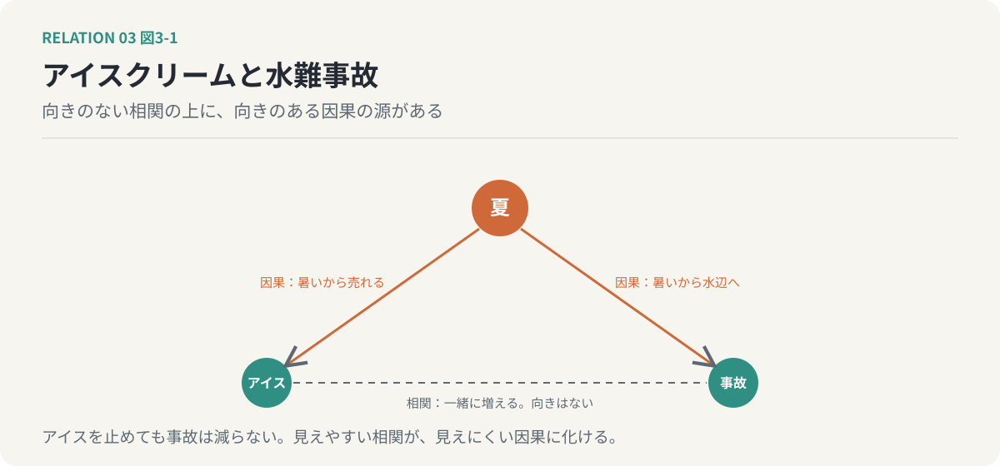
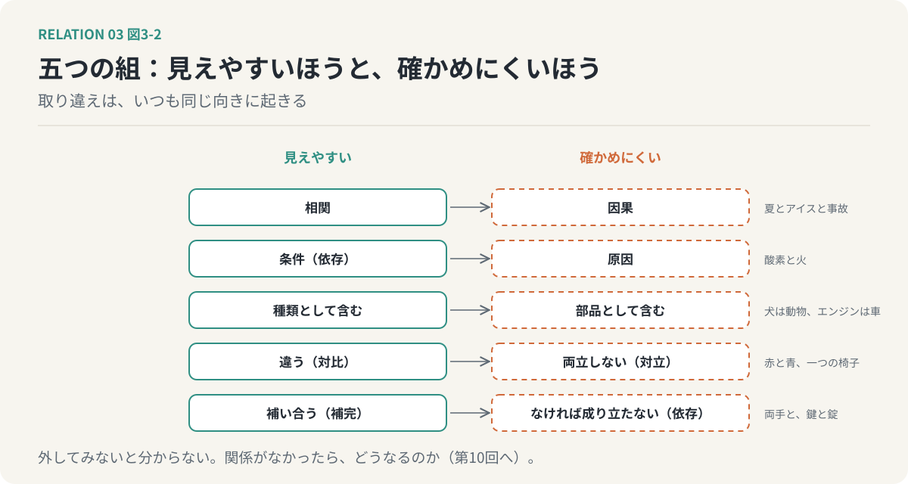

# 第3回　混同しやすい五つの区別

## 相関と因果、依存と因果、包含と構成、対立と対比、補完と依存

<!-- NAV:TOP -->
[← 第2回](02-meaning-and-structure.md) | [連載目次](../README.md) | [第4回 →](04-comparative-relations.md)
<!-- /NAV -->

アイスクリームの売上が伸びる月には、水難事故も増えます。これは古くから知られた話で、数字を並べれば確かにそうなります。では、アイスクリームの販売を止めれば、水難事故は減るでしょうか。減りません。両方を増やしているのは夏です。暑いからアイスが売れ、暑いから人が水辺へ行く。

誰もが笑う例ですが、同じ取り違えは、笑えない形で日常に潜んでいます。関係の種類には、意味が近く取り違えやすい組がいくつかある。前回の「形を見る」という道具を使いながら、五つの組を見分けていきます。

### 相関と因果

一緒に変化することと、一方が他方を引き起こすことは、別です。

形を見ると、違いははっきりします。相関には向きがありません。アイスが増えると事故が増える、と言っても、事故が増えるとアイスが増える、と言っても同じことです。因果には向きがあります。暑さがアイスを売り、暑さが人を水辺へ連れていく。向きのない関係を、向きのある関係だと思い込んだとき、人は「アイスを止めれば」という誤った手を打ちます。

取り違えが起きるのは、相関のほうが観察しやすいからです。数字を二列並べれば相関は見える。因果を確かめるには向きを確かめる手続きが要り、それを省くと、見えやすいほうが見えにくいほうに化けます。

*図3-1：アイスクリームの売上と水難事故は一緒に増えるが、二つの間に向きはない。向きのある線は、頂点の「夏」から両方へ降りている。見えやすい相関が、見えにくい因果に化ける典型。*

### 依存と因果

一方が他方の成立条件であることと、一方が他方を発生させることも、別です。

火は酸素に依存しています。酸素がなければ火は燃えない。しかし、酸素が火を引き起こすわけではありません。部屋に酸素があるだけでは、火はつかない。依存は「それがなければ成り立たない」という条件の関係で、因果は「それがあるから起きる」という発生の関係です。

取り違えると、条件を整えれば結果が起きると思い込みます。レビューの体制を作れば品質が上がる、と期待する。体制は条件であって原因ではなく、条件が揃っても原因が動かなければ何も起きません。逆に原因だけを見て条件を忘れると、原因が動いているのに結果が出ない理由が分からなくなる。

### 包含と構成

種類として含まれることと、部品として含まれることは、別です。

犬は動物に含まれます。これは種類の包含で、犬は動物の一種です。エンジンは自動車に含まれます。これは部品の構成で、エンジンは自動車の一種ではありません。どちらも「含む」と言えるのに、意味がまるで違う。

違いは、性質が受け継がれるかどうかに出ます。動物は呼吸する、犬は動物である、だから犬は呼吸する。種類の包含では、上位の性質が下位へ降りてきます。自動車は走る、エンジンは自動車の部品である、だからエンジンは走る。これは成り立ちません。部品は全体の性質を受け継がない。

第1クールの第5回で、意味の階層を双曲空間の木として描きました。あの木の枝は種類の包含でできていて、部品の構成はその木とは別の軸です。会社という木の枝に部署をぶら下げると、部署が会社の一種になってしまう。組織図の多くが読みにくいのは、二つの「含む」を一本の線で描いているからです。

### 対立と対比

異なる性質を持つことと、互いに両立しないことも、別です。

赤と青は違います。共通の軸、つまり色の上で、別の場所にある。しかし赤と青は両立します。赤い服と青い鞄を同時に身につけられる。これが対比です。一方、一つの椅子に二人は座れない。同じ席を争うとき、一方が座れば他方は座れない。これが対立です。

取り違えると、違いを衝突だと思い込んで、選ばなくてよいところで選択を迫ります。速度と品質は対立する、とよく言われます。しかし多くの場合、それは対比です。速くて質の高い仕事はあるし、遅くて質の低い仕事もある。本当に対立しているのは、同じ時間という席を、急ぐ作業と確かめる作業が奪い合うときだけです。対比を対立と見ると、第1クールの第9回で言った「A、B or C」のCが、最初から視界に入らなくなります。

### 補完と依存

互いを補うことと、一方がなければ成立しないことも、別です。

右手と左手は補い合います。片手でも多くのことはできますが、両手ならもっとできる。これが補完で、どちらも単独で成り立ったうえで、組み合わせると足りないところが埋まる。鍵と錠は違います。錠のない鍵は何も開けないし、鍵のない錠は開かない。一方がなければ他方は役に立たない。これが依存で、しかも両側から依存している。

形で言えば、補完は双方向で、強度が両側とも「あればよい」程度にとどまります。依存は、片側か両側が「なければ成り立たない」強度に達している。取り違えると、二つの誤りが起きます。補完を依存と見て、片方を失うとすべてを失うと怯える。依存を補完と見て、片方は外せると軽く考える。

### 五つに共通すること

五つの組を並べると、同じ型が見えてきます。どの組も、見えやすいほうと確かめにくいほうでできている。相関は見えやすく、因果は確かめにくい。条件は見えやすく、原因は確かめにくい。違いは見えやすく、両立するかは試さないと分からない。補い合う様子は見えやすく、なければ成り立たないかは、外してみないと分からない。

最後の一文に、少しだけ立ち止まってください。外してみないと分からない。関係がなかったら、どうなるのか。この問いは、第III部の終わりでもう一度、正面から取り上げます。

*図3-2：五つの組は、どれも見えやすいほうと確かめにくいほうでできている。取り違えは、いつも見えやすいほうが確かめにくいほうに化ける向きに起きる。*

### 適用：AIの生成と、人間のレビュー

レビューを丁寧にするチームは、欠陥が少ない。この観察は、たいていのところで成り立ちます。ではこれは、相関でしょうか、因果でしょうか。

レビューが欠陥を減らしている、という因果はありそうです。しかし逆向きの因果もありえます。欠陥の少ないコードはレビューが通りやすく、結果としてレビューが丁寧に見える。さらに、第三の原因もありえます。丁寧なチームは、生成の指示も丁寧で、レビューも丁寧で、欠陥も少ない。夏がアイスと事故を両方増やしたように。

第1回で挙げた「依存」も言い直せます。レビューは生成に依存していますが、レビューが欠陥の減少を引き起こしているかは、依存とは別に確かめなければならない。そして生成とレビューが補完なのか依存なのかも、まだ決まっていません。片方を外したら全体がどうなるかを、見ていないからです。

### 次回へ

五つの組は、どれも「見分ける」ための道具でした。次回からは、関係の種類を群ごとにめぐります。最初の群は、見比べることで何かが生まれる関係です。似ている、反対である、逆である、双対である、同型である、類比が成り立つ。これらは、第1クールで創造的思考の核に置いた「関係を見出す」という行為に、最も近いところにある関係です。

<!-- NAV:BOTTOM -->
---

[← 第2回](02-meaning-and-structure.md) | [連載目次](../README.md) | [第4回 →](04-comparative-relations.md)
<!-- /NAV -->
