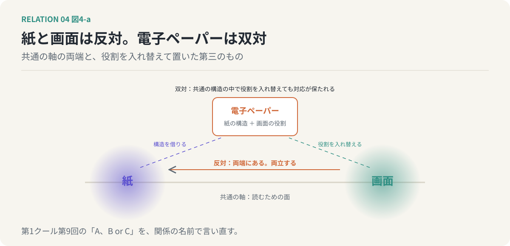
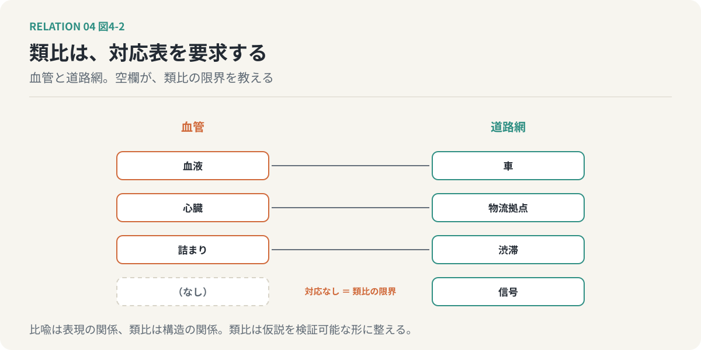

# 第4回　比較の関係 ── 相似・反対・逆転・双対・同型・類比

## 見比べることで、第三の認識が生まれる関係

<!-- NAV:TOP -->
[← 第3回](03-five-distinctions.md) | [連載目次](../README.md) | [第5回 →](05-functional-relations.md)
<!-- /NAV -->

第1クールの第9回で、紙と画面の話をしました。紙か画面か、という二択のせめぎ合いの間隙から、紙でも画面でもある電子ペーパーが現れる。あのとき、わたしはこれを「A、B or C」と呼びました。

今回の言葉で言い直すと、紙と画面は、読むための面という共通の軸の上で反対の性質を持つ、反対の関係にあります。そして電子ペーパーは、紙の構造の中に画面の役割を入れ替えて置いたもの、つまり双対的な発明だった、と読めます。第1クールでは「ふいに現れる」としか言えなかったCの出どころを、今回は関係の種類の側から照らしてみます。

*図4-1：紙と画面は、共通の軸の両端にある反対の関係で、両立する。電子ペーパーは、紙の構造の中に画面の役割を入れ替えて置いた双対的な発明として読める。*

### 比較の関係とは

今回扱うのは、二つのものを見比べることで成り立つ関係の群です。似ている、反対である、逆である、双対である、同型である、類比が成り立つ。前回までの関係と違うのは、これらが二者の間にもともとあるというより、見比べる人の側で立ち上がる、という点です。

第1クールで、関係は見出されるものであり、見出すことがアイデアだと述べました。比較の関係は、その「見出す」に最も近いところにあります。見比べると、二つのどちらにもなかった第三の認識が生まれる。だからこの群は、創造的思考のための関係だと言えます。

### 相似：知っていることを、知らないものへ運ぶ

AとBに共通する構造や性質がある。これが相似です。第1クールの全体が、この関係を扱っていたと言ってよい。

相似が生むのは、転用です。Aについて知っていることを、Bへ持ち込める。心臓はポンプに似ている、と気づいた人は、ポンプについて知っていたことを心臓に当てはめて、血液が循環していると考えました。相似は、既知を未知へ運ぶ橋です。

ただし、第2回の言葉で言えば、相似は対称で、推移しない。AがBに似て、BがCに似ていても、AからCへは運べない。橋は一本ずつ架け直さなければなりません。

### 反対：際立たせる

AとBが、共通の軸の上で反対の性質を持つ。これが反対です。光と影、速いと遅い、紙と画面。

反対が生むのは、際立ちです。一つのものを単独で見ているときには気づかない特徴が、反対のものを隣に置くと浮かび上がる。紙の「目に優しい」という性質は、画面を隣に置くまで、わざわざ言う必要のないことでした。反対は、特徴に名前を与える関係です。

前回の対立と対比の区別を思い出してください。反対は対比の一種で、両立しないことを意味しません。光と影は共存します。反対を対立と取り違えると、際立たせるために置いた隣人を、排除すべき敵だと思い込みます。

### 逆転・同型・双対

残りの三つは、短く。

逆転は、AとBの方向、順序、役割が逆であることです。教える人と教わる人を入れ替えてみる。先に作って後で確かめる、を、先に確かめる基準を作って後で作る、に入れ替えてみる。逆転が生むのは、暗黙の前提の発見です。入れ替えて初めて、「なぜこちらが先だと思い込んでいたのか」が見える。

同型は、構成要素が違っても構造が同じであることです。将棋の詰みと、交渉の袋小路。要素は盤上の駒と人間で、まったく違う。しかし「次の一手がすべて悪手になる状態」という構造は同じです。同型が生むのは、解法の使い回しです。一方で効いた手が、他方でも効く。

双対は、共通の構造の中で、役割を入れ替えても対応が保たれることです。買い手と売り手、問いと答え、教えることと学ぶこと。一方の構造から、他方の性質が導ける。冒頭の電子ペーパーは、紙の構造の中で画面の役割を担わせたものでした。双対は、逆転と同型が重なったところに現れます。

### 類比：対応表を要求する関係

最後に、類比。異なる領域のAとBの間に、対応する関係の構造がある。血管と道路網。血液と車、心臓と物流拠点、詰まりと渋滞。

類比は相似に似ていますが、要求するものが違います。相似は「似ている」で済みます。類比は、何が何に対応するのか、その対応がどこまで成り立ち、どこから成り立たないのかを、表にして示せなければなりません。血管には渋滞があるが、信号はない。対応表の空欄が、類比の限界を教えてくれます。

ここで、第1クールの第9回で扱った比喩との線引きをしておきます。「市場は熊だ」は比喩です。熊と市場の対応表は要らない。言葉を重ねた瞬間に、何かが立ち上がれば足りる。類比は違います。「市場は生態系だ」と言ったら、捕食者は誰で、資源は何で、絶滅は何に当たるかを答えなければならない。比喩は表現の関係で、類比は構造の関係です。比喩は仮説を一瞬で生み、類比はその仮説を検証可能な形に整えます。

*図4-2：類比は対応表を要求する。何が何に対応するかを示せるのが類比で、対応のない空欄（信号）が、類比の成り立つ範囲の限界を教える。*

### 変換という裏側

比較の関係の裏には、変換の関係が控えています。拡張、縮小、抽象化、具体化。

相似や類比を見出すとき、わたしたちは二つのものから共通の構造を取り出しています。これは抽象化という変換です。第1クールの双曲空間で言えば、縁の具体から中心の抽象へ登る動き。逆に、抽象化した構造を別の領域に降ろすのが具体化で、これが転用の実体です。比較の関係は、登って降りるこの往復の、登った地点で見えるものだと言えます。

### 適用：AIの生成と、人間のレビュー

生成とレビューは、まず反対の関係にあります。作ることと、壊そうとすること。生成は可能性を広げ、レビューは可能性を絞る。この反対が、互いの特徴を際立たせています。レビューの「疑う」という性質は、生成の「信じて進む」という性質を隣に置くまで、名前を持ちませんでした。

同時に、二つは双対でもあります。提案と検証という共通の構造の中で、役割を入れ替えても対応が保たれる。人間が生成し、AIがレビューする構成は、すでに実際に使われています。役割を逆転させてみると、暗黙の前提が一つ見えます。「生成はAI、検証は人間」という割り当ては、必然ではなく、ある時点の選択だったということです。

そして相似。生成もレビューも、入力を受け、処理し、出力する、という同じ形をしています。この相似から、生成側で効いた工夫をレビュー側へ運べるかもしれない、という転用の仮説が立ちます。まだ仮説です。

### 次回へ

比較の関係は、見比べる人の側で立ち上がる関係でした。次回は、二者が実際に何かをし合っている関係を扱います。補い合う、代わりをする、奪い合う、頼る、協力する、分担する。役割の関係です。同じ二人が、仕事では補完し合い、昇進では競合する。その違いはどこから来るのかを問います。

<!-- NAV:BOTTOM -->
---

[← 第3回](03-five-distinctions.md) | [連載目次](../README.md) | [第5回 →](05-functional-relations.md)
<!-- /NAV -->
