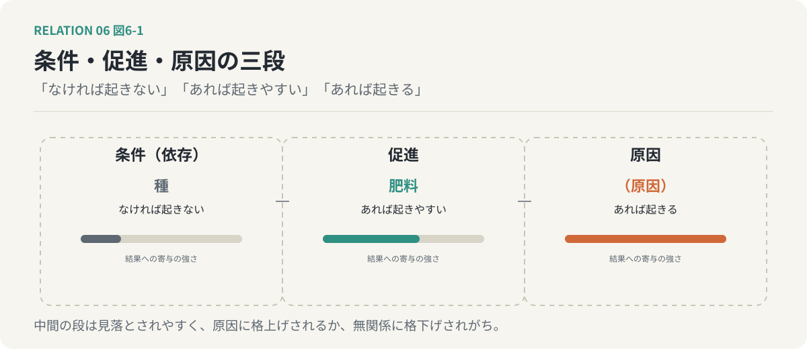
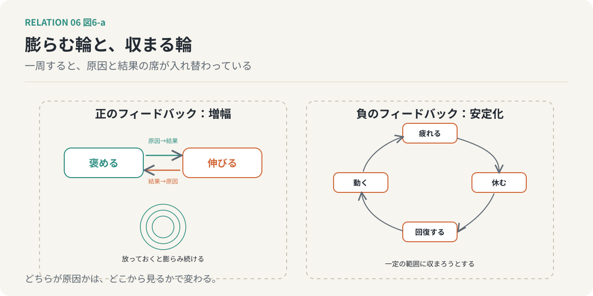
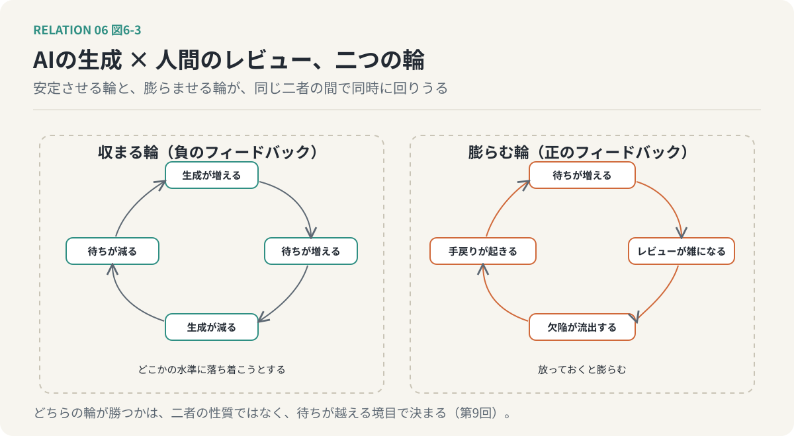

# 第6回　因果と時間の関係 ── 原因・促進・抑制・フィードバック・循環

## 原因と結果の席は、入れ替わる

<!-- NAV:TOP -->
[← 第5回](05-functional-relations.md) | [連載目次](../README.md) | [第7回 →](07-semantic-relations.md)
<!-- /NAV -->

第1クールの第6回で、「一見、関係なさそう」という判定には時間の指標が隠れている、と書きました。「現時点では」関係なさそうに見えるだけで、「これから関係していく」のかもしれない。関係は時間の中で現れる、という話でした。

今回扱うのは、時間の中でしか成り立たない関係の群です。その代表が因果です。原因は結果より先に起きる。この当たり前の順序が、因果を他の関係から分けています。そして、原因と結果が時間の中で繰り返し向かい合うと、どちらが原因でどちらが結果かという区別そのものが揺らぎはじめます。今回の主張は、そこにあります。

### 因果の形

AがBを引き起こす。第2回の軸で言えば、因果は有向で、非対称で、しかも時間の順序を含みます。Aが先、Bが後。この順序は、因果の必要条件です。後に起きたものが先に起きたものを引き起こすことはない。

しかし、順序は十分条件ではありません。鶏が鳴いて、日が昇る。先に鳴いたからといって、鶏が太陽を引き起こしたわけではない。第3回で、相関と因果の違いを向きの有無で見分けました。今回はそこに時間を足します。因果を主張するには、向きがあること、時間の順序が合っていること、そして、AからBへ至る仕組みが説明できること。この三つが要ります。三つのうち一つでも欠けていれば、それは相関か、ただの前後です。

### 促進と抑制

因果には、度合いの薄い形があります。AがBを引き起こすのではなく、Bが起きやすくなる、速くなる。これが促進です。逆に、起きにくくなる、遅くなる。これが抑制です。

肥料は植物を生みません。種がなければ、肥料をいくら撒いても芽は出ない。しかし肥料は成長を速めます。日陰は成長を遅らせます。肥料も日陰も、原因ではなく、促進と抑制です。

第3回の言葉で言えば、促進と抑制は、条件より強く原因より弱い、中間の関係です。条件は「なければ起きない」、原因は「あれば起きる」、促進は「あれば起きやすい」。この中間は見落とされやすく、原因に格上げされるか、無関係に格下げされがちです。

ここで一つ、言葉の注意を。「促進」という語は、関係の種類としても、関係が生んだ結果としても使われます。肥料と成長の関係が促進であることと、その結果として成長が速まったことは、別の層の話です。この区別は第8回で正面から扱います。

*図6-1：条件は「なければ起きない」、促進は「あれば起きやすい」、原因は「あれば起きる」。種と肥料のように、中間の段は見落とされやすい。*

### 時間の関係

因果を離れて、時間そのものがつくる関係を見ておきます。先行と後続、同時、重複、反復、循環、継承。

これらは因果を含みません。同時に起きた二つのことの間に因果はなく、繰り返し同じ順番で現れる稲光と雷鳴も、一方が他方を引き起こしてはいない。時間の関係は因果の土台にはなるが、因果そのものではない。

継承だけは性格が違います。Bが先行するAの性質や状態を引き継ぐ。子は親を、今日の自分は昨日の自分を継承する。継承は時間の関係でありながら、同一性の関係の仲間でもあります。

### フィードバック

いよいよ本題です。Aの結果が、Bを介して、Aに戻ってくる。これがフィードバックです。

褒めると、伸びる。伸びると、褒められる。最初の「褒める」は原因で、「伸びる」は結果でした。しかし伸びたことが次の「褒める」を引き起こすとき、伸びることは原因になり、褒めることは結果になっています。一周すると、席が入れ替わっている。

戻ってくる作用が、元の動きを強めるものを、正のフィードバックと呼びます。褒めると伸び、伸びると褒められる、は正の例で、放っておくと膨らみ続けます。戻ってくる作用が元の動きを弱めるものを、負のフィードバックと呼びます。疲れると休み、休むと回復し、回復すると動き、動くと疲れる。こちらは一定の範囲に収まろうとします。正は増幅し、負は安定させる。

フィードバックのある関係では、「どちらが原因か」という問いが、意味を失いはじめます。どこから見るかで、原因の席が変わるからです。第1クールの「間にある」と「中にある」が、どの範囲を一塊と見るかで切り替わったのと同じ構造が、時間の中にも現れます。

*図6-2：左は正のフィードバックで、一周すると原因と結果の席が入れ替わり、放っておくと膨らむ。右は負のフィードバックで、一定の範囲に収まろうとする。*

### 循環

フィードバックが繰り返されると、循環になります。AからBを経て、再びAへ戻る系列。

循環の中には、始まりがありません。鎖には端がありますが、輪にはない。だから循環する関係を前にして「元を正せば何が原因か」と問うても、答えは出ません。問えるのは、輪のどこに手を入れれば、回り方が変わるか、だけです。因果の鎖を探すのをやめて、輪の介入点を探す。これが、循環を扱うときの発想の切り替えです。

### 関連は仮説に過ぎない、三たび

第1クールのリフレインを、因果に当てます。因果は、向き、時間の順序、仕組みの三つが揃って初めて主張できる。揃ったように見えても、検証されるまでは仮説です。

しかも、フィードバックのある系では検証そのものが難しい。Aに手を入れて結果を見ようとしても、その結果がAに戻ってきて、手を入れた効果と混ざる。単純な介入実験が輪の中では成り立ちにくく、因果の仮説はいっそう仮説に留まります。

### 適用：AIの生成と、人間のレビュー

前回の終わりに置いた連鎖を、今回の言葉で描き直します。

生成が増える。レビューの待ちが増える。待たされた生成側は、次の生成を控えるか、検証されないまま積み上げる。生成が減ると、待ちが減る。待ちが減ると、また生成が増える。これは負のフィードバックで、系は振動しながら、どこかの水準に落ち着こうとします。

しかし、別の輪も回りえます。待ちが増えると、レビューが急いで雑になる。雑になると、欠陥が流出する。欠陥が流出すると、手戻りが起きる。手戻りが起きると、待ちがさらに増える。こちらは正のフィードバックで、放っておくと膨らみます。

同じ二者の間で、安定させる輪と、膨らませる輪が、同時に回りうる。どちらの輪が勝つかは、二者の性質では決まりません。待ちがどの水準を越えたときに、レビューが雑になりはじめるか。その境目で決まります。境目の話は、第9回で扱います。

*図6-3：左は生成が増えると待ちが増え、生成が減ると待ちが減る負のフィードバック。右は待ちが増えるとレビューが雑になり、欠陥が流出し、手戻りで待ちがさらに増える正のフィードバック。同じ二者の間で両方が回りうる。*

### 次回へ

因果と時間の関係は、世界の中で起きる関係でした。次回は、言葉の中で起きる関係を扱います。連想、共起、比喩、象徴、含意、そして一つの言葉に複数の解釈が成り立つ解釈競合。「レビュー」という一語が、検査なのか、承認なのか、学習なのかによって、生成との関係そのものが変わります。意味が似ていることと、意味的に関連していることは別だ、というところから始めます。

<!-- NAV:BOTTOM -->
---

[← 第5回](05-functional-relations.md) | [連載目次](../README.md) | [第7回 →](07-semantic-relations.md)
<!-- /NAV -->
