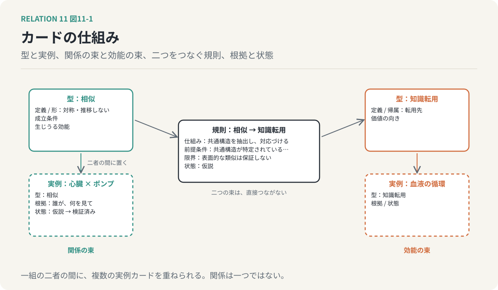
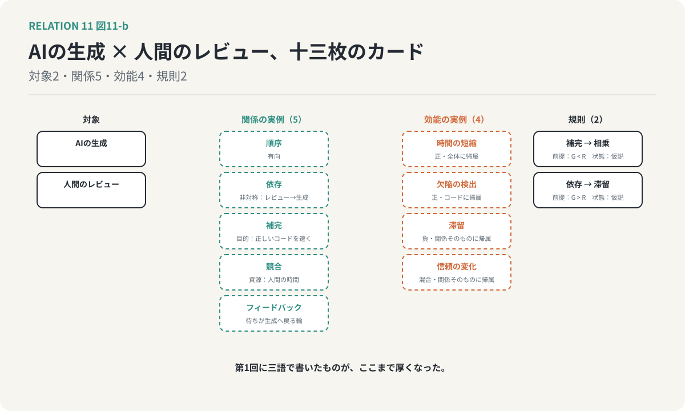

# 第11回　関係を知識にする ── Entityとしての関係

## 線そのものに、名前と性質を持たせる

<!-- NAV:TOP -->
[← 第10回](10-counterfactual-value.md) | [連載目次](../README.md) | [第12回 →](12-designing-relations.md)
<!-- /NAV -->

第1クールの第7回で、「関心空間」という試みに触れました。人と、その人が関心を持つキーワードを、同じ図の上に並べる。人とキーワードの間に線を引き、線を介して、直接の面識のない人同士が結ばれる。

あの図の線は、「関係がある」としか言っていませんでした。第2クールで分けてきた種類、形、効能、条件、価値は、どれも線の上に載っていない。今回は、それらを線そのものに載せます。関係を、書き留めて、比べて、再利用できる知識にする話です。

### 関係を一枚のカードにする

一つの関係を、一枚のカードだと考えてください。

「相似」のカードには、こう書いてあります。定義。異なる対象の間に共通する構造や性質がある。形。対称で、推移しない。成立条件。比較する属性や構造を明示でき、共通性を観察または記述できる。生じうる効能。知識の転用、発見、学習。例。心臓とポンプ。

「補完」のカードにも、同じ項目が別の中身で書いてあります。第II部でめぐった関係の種類は、こうしたカードの束です。

大事なのは、このカードが型だということです。「相似」のカードは一枚しかないが、相似という関係にある二者の組は無数にある。心臓とポンプ、レビュー滞留と仕掛品滞留。それぞれの組は、「相似」のカードを二者の間に置いた実例です。型と実例を分けると、「相似とは何か」を一か所に書けば済み、何千の実例がそこを参照します。

### 効能も、別の束のカードにする

関係が生むものも、同じ仕組みにします。「知識転用」の型カード。定義、帰属、価値の向き。そして、実際に観測された転用の実例カード。いつ、どの二者の間で、何が運ばれたか。

第III部のリフレインを、ここで回収します。種類と効能を混同しない。カードの言葉で言えば、関係の型の束と、効能の型の束を、別の束にしておく、ということです。混同とは、二つの束を一つにしてしまうことです。「相似」のカードに「転用が起きる」と書き込んでしまえば、相似があるのに転用が起きなかった実例を、どこにも書けなくなります。

### 型と型をつなぐ、規則のカード

では、「相似」と「知識転用」はどうつながるのか。直接にはつなぎません。間に、もう一種類のカードを置きます。規則のカードです。

「相似から知識転用へ」の規則カードには、こう書きます。仕組み。共通構造を抽出し、既存の知識を別の対象に対応づける。前提条件。共通構造が特定されている。転用元の知識が存在する。転用先で成立条件を検証できる。限界。表面的な類似は転用の妥当性を保証しない。状態。仮説。

第8回で、関係の種類と効能は多対多で対応し、その対応は保証ではないと書きました。あの対応表は、規則カードの束です。そして第9回で見た発現条件は、規則カードの前提条件の欄に書き込まれます。閾値、遅延、不可逆性。知識にすると、条件が条件として残ります。

### 根拠と、仮説という状態

実例のカードには、もう二つの欄があります。根拠と、状態です。

この二者の間に相似があると、誰が何を見て言ったのか。それが根拠です。まだ見立ての段階か、確かめられたのか。それが状態です。第1クールのリフレインをここで回収します。関連は仮説に過ぎない。実例カードの状態欄は最初は必ず「仮説」で、検証を経て初めて「検証済み」に書き換えられる。

確信の度合いを数字で添えることもできます。ただし、その数字は確率ではありません。誰が、どういう手続きで出した数字なのかを添えなければ、別のカードの数字と比べることはできない。数字は、根拠の代わりにはならない。

*図11-1：カードの仕組み。関係の束と効能の束は直接つながず、前提条件・限界・状態を持つ規則カードが間に立つ。実例カードは根拠と状態の欄を持ち、状態は最初は必ず仮説。*

### 重ねられること

最後に、第1回のリフレインを回収します。関係は一つではない。

カードの仕組みで言えば、一組の二者の間に、複数の実例カードを置けなければならない、ということです。相似のカードと、競合のカードが、同じ二者の間に重なっている。どちらか一枚を選ぶ排他的な分類ではなく、何枚でも重ねられる仕組み。第1回の主張は、ここでは設計の要件になります。

### 何ができるようになるか

カードにすると、頭の中の見立てではできなかった操作ができるようになります。

相似の関係にある組を、型で検索する。反対の関係だけを抜き出す。創発を生みうる関係の型を規則カードから逆引きし、その型の実例を探す。状態が「仮説」のままの実例を一覧にして、次に検証すべきものを選ぶ。どれも、関係をカードにしていなければ、できない操作です。そしてこれらは、次回の「関係を設計する」ための準備です。

### 鏡：LLMと知識グラフは、線をどう扱っているか

第2クールで一度だけ、第1クールの型を使います。

知識グラフは、線に型を持っています。主語と述語と目的語で、述語が関係の型です。しかし多くの知識グラフは、効能のカードも規則のカードも、根拠と状態の欄も持っていない。線が何を生み、どの条件で、どこまで確かめられたかは載っていない。第1クールの第7回で触れた、LLMの検索を補うグラフはもっと薄く、線は「同じ文書に出てきた」程度です。LLMそのものの中では、関係は分布として溶けていて、カードの形をしていません。カードにする作業は、今のところ人間の側に残っています。

ただし、LLMはカードの下書きを安く作れます。「この二者の間にどんな関係がありそうか」と問えば、相似も競合も依存も、候補としていくらでも出してくる。第1クールの言葉で言えば、生成は安い。状態欄を「仮説」から「検証済み」に書き換える作業だけが、高いまま残る。

### 適用：AIの生成と、人間のレビュー

共通例を、カードの言葉で一度だけ記述します。全文は付録に置き、ここでは骨だけ。

対象のカードが二枚。AIの生成と、人間のレビュー。関係の実例カードが五枚。順序、有向。依存、非対称で、レビューから生成へ。補完、目的は正しいコードを速く届けること。競合、資源は人間の時間。フィードバック、待ちが生成へ戻る輪。効能の実例カードが四枚。時間の短縮、正、全体に帰属。欠陥の検出、正、コードに帰属。滞留、負、関係そのものに帰属。信頼の変化、混合、関係そのものに帰属。規則のカードが二枚。補完から相乗へ、前提条件は生成の速さがレビューの処理能力を下回ること。依存から滞留へ、前提条件はその逆。どちらも状態は仮説で、第9回の記述が根拠です。

十三枚のカードで、第1回に「順序、依存、補完」と三語で書いたものが、ここまで厚くなりました。

*図11-2：第1回に三語で書いた生成とレビューの関係が、十三枚のカードになった。関係の実例五枚、効能の実例四枚、規則二枚。規則の状態はどちらも仮説。*

### 次回へ

カードが揃いました。最終回は、このカードを使って、関係を設計の対象にします。個々の対象の性能ではなく、対象と対象の間を設計する。生成を速くするのでも、レビューを厳しくするのでもなく、二者の間の規則カードの前提条件を、どう書き換えるか。四つの階層を一度に使って、共通例の最終形を描きます。

<!-- NAV:BOTTOM -->
---

[← 第10回](10-counterfactual-value.md) | [連載目次](../README.md) | [第12回 →](12-designing-relations.md)
<!-- /NAV -->
