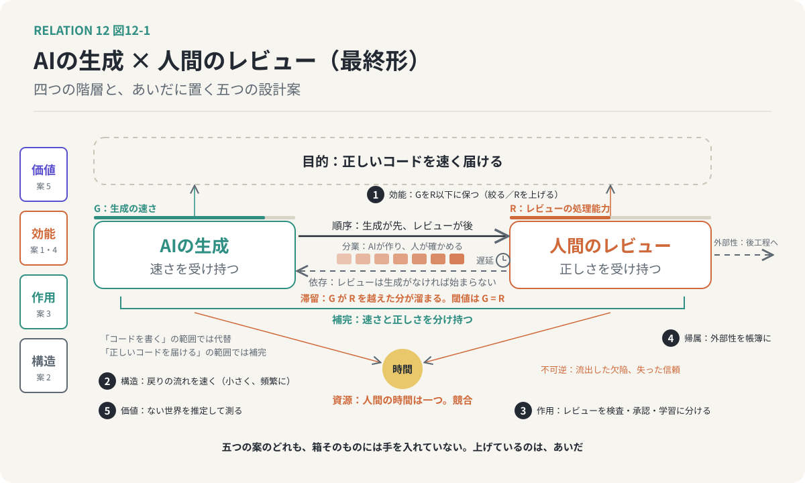

# 第12回　関係を設計する

## 個々の性能ではなく、あいだを設計の対象にする

<!-- NAV:TOP -->
[← 第11回](11-relations-as-entities.md) | [連載目次](../README.md)
<!-- /NAV -->

第1回で、第2クールの問いを一つに絞りました。二者のあいだに「関係がある」と言うとき、それはどの関係で、何を生み、何と比べて価値があるのか。11回かけて部品を揃えたので、最終回はそれらを束ねて答えを返し、そのうえで、関係を設計の対象にするところまで行きます。

### 関係は重なりであり、意味と形は別の軸

出発点は、和歌山と愛媛でした。第1クールで「みかんでつながっている」と書いたものは、仲間であり、競争相手であり、比べられる相手でもあった。関係は一つではなく、性質の違う複数の関係型が重なった状態です。親子が、依存であり、継承であり、全体と部分であり、対立でもあるように。

その重なりをほどく最初の道具が、意味と形の分離でした。何によって結びついているかという意味と、どういう形でつながっているかという構造。向き、対称性、強度、時間変化、そして推移性。似ているは対称で推移せず、含むは非対称で推移する。関係の名前が決まる前に、形は問えます。そして形を見ると、意味が近くて取り違えやすい五つの組、相関と因果、依存と因果、包含と構成、対立と対比、補完と依存が、見分けられるようになりました。

### 四つの群は、違う場所で立ち上がる

関係の種類を、四つの群でめぐりました。比較の関係は、見比べる人の側で立ち上がり、転用や際立ちや前提の発見という第三の認識を生みます。機能の関係は、目的と範囲と資源の枠で決まり、同じ二者が補完にも競合にも代替にもなります。因果と時間の関係は、世界の中で起き、フィードバックで輪になると、原因と結果の席が入れ替わります。意味の関係は、言葉の中で起き、意味の近さと構造の似方が別の軸をなすので、意味的に遠いが構造的に似た組が、転用の着想源になります。

### 種類は効能を保証せず、効能は条件で反転し、価値は差である

関係の種類と、関係が生むものは、別です。相似があっても転用が起きるとは限らず、分業は効率と依存を同時に生む。効能はAにも、Bにも、二者の間にも、二者を含む全体にも帰属し、外側へ漏れもする。

効能は、関係の種類だけでは決まりません。閾値を越えれば符号が反転し、遅れて現れ、累積し、戻せないものもある。二者がそれぞれ優れていても、関係の条件が崩れれば、全体は悪化する。

そして価値は、効能の列挙からは出てきません。関係がある世界と、ない世界の差。観測できない側を想像で組み立てる、反実仮想の比較。そこから関係を維持する費用を引き、誰にとっての価値かを添えて、初めて正味の価値になる。

### 設計するとは、どの階層に手を入れることか

関係をカードにしたのは、設計のためでした。設計するとは、四つの階層のどこかに手を入れることです。

構造の階層では、形を変えます。向きを足す、戻りの流れを速くする、強度を調整する。作用の階層では、役割の分担を変えます。誰が何を受け持つかを組み直す。効能の階層では、条件を変えます。閾値を越えないように、規則カードの前提条件を保つ。価値の階層では、比較の相手を用意します。ない世界を推定する仕組みを置き、関係の正味の価値を測れるようにする。

どの階層でも、手を入れる先は対象ではなく、対象のあいだです。AをもっとAらしく、BをもっとBらしくするのではない。AとBの間にある規則カードの、前提条件の欄を書き換える。

### 適用：AIの生成と、人間のレビューの最終形

共通例を、四階層で一度に記述します。

構造。生成からレビューへの有向な流れと、レビューから生成へ戻る遅い流れ。非対称な依存。生成の質と量に連動して動く強度。

作用。順序、依存、補完、競合、フィードバック。目的は正しいコードを速く届けること、資源は人間の時間。

効能。直接には時間短縮と欠陥検出。間接には滞留と手戻りと信頼の変化。全体への効能の符号は、生成の速さGがレビューの処理能力Rを下回るか上回るかで反転する。

価値。レビューがない世界、生成がない世界との差。条件つきで、費用を引き、立場によって違う。

この記述の上に、設計案を置きます。生成をもっと速くする、でもなく、レビューをもっと厳しくする、でもありません。どちらも対象に手を入れる案で、関係には触れていないからです。

効能の階層。GがRを越えないように保つ。生成を絞るか、Rを上げる。制約理論が教えたとおり、全体を決めているのは遅い側です。

構造の階層。戻りの流れを速くする。大きな生成物を一度に渡すのではなく、小さく、頻繁に渡す。フィードバックの遅延が縮めば、第6回の膨らむ輪が回りはじめる前に、安定させる輪が効きます。

作用の階層。「レビュー」という一語に押し込まれていた三つの解釈を、三つの関係に分けて設計する。検査は、生成とは別のAIにも担わせられる。承認は、人間が受け持つ。学習は、人間とAIの双方向に開く。第4回で見た役割の逆転が、ここで設計の選択肢になります。

外部性。滞留が後工程へ波及する分を、二者の帳簿に載せる。載せなければ、誰も対処しません。

価値の階層。レビューがなければ流出していた欠陥を推定する仕組みを置く。推定の穴を自覚したまま、それでも測る。測らなければ、関係の価値は言えず、設計の良し悪しも言えません。

五つの案のどれも、生成とレビューそれぞれの性能を上げてはいない。上げているのは、二者のあいだです。

*図12-1：共通例の最終形。左に構造・作用・効能・価値の四階層、あいだに五つの設計案。どの案も生成とレビューの箱そのものには手を入れず、二者のあいだを変えている。*

### 第1クールへの応答

第1クールの最終回に残した問いに、答えを返します。評価の目は、どこから来るのか。

第2クールを通ってきた今、評価の目は三つの力でできていると言えます。関係の種類を分ける力。効能がどの条件で現れるかを知る力。そして、ない世界を想像して、ある世界と比べる力。この三つは、生まれつきの感覚ではなく、問いの癖です。これはどの関係か。いつ反転するか。関係がなかったらどうなっていたか。問うたびに、目は少しずつ鍛えられる。

もう一つ、第2クールの途中で見えてきたことがあります。関係を認識すること自体が、新しい知識を生む、ということです。二つのものの間に相似を見出すと、共通の構造が抽象化され、一方の知識が他方へ運ばれ、他方について新しい仮説が生まれる。関係は、対象について何かを教える以上に、関係を見た人の側を変える。第1クールで「関係を見出すことがアイデアだ」と言ったことの中身は、これでした。

### 答え

二者のあいだに「関係がある」と言うとき、それはどの関係で、何を生み、何と比べて価値があるのか。

それは、性質の違う複数の関係型が重なった状態であり、それぞれが向きと強度と時間変化という形を持ち、条件つきで効能を生み、効能は二者の中にも間にも全体にも帰属し、価値は関係がない世界との差としてしか測れない。そして、この記述ができるようになったとき、関係は観察の対象であることをやめて、設計の対象になる。

個々の対象の性能ではなく、対象と対象のあいだを設計する。これが、第2クールの到達点です。

### 次の問い

二者で、ここまで来ました。しかし、第9回の外部性も、第1クールの2ホップの媒介も、すでに三者目を呼び込んでいました。第三者が入ると、何が変わるのか。二者の関係を仲介する者、二者の関係から漏れた効能を受け取る者、二者を見ている観察者。三者になった瞬間に、関係の数は三本になり、関係同士の関係が現れます。それは、次の連載の問いになります。

<!-- NAV:BOTTOM -->
---

[← 第11回](11-relations-as-entities.md) | [連載目次](../README.md)
<!-- /NAV -->
